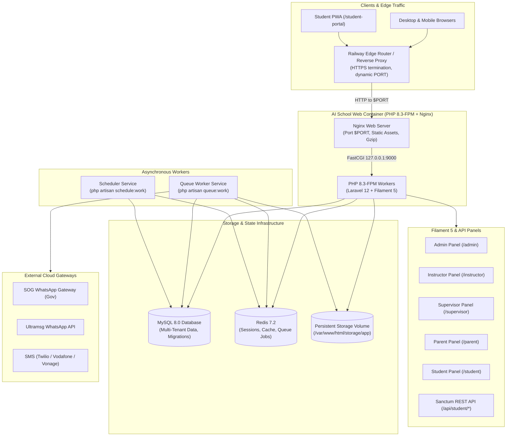

# AI School — Production Docker & Railway Deployment Guide

This document is the definitive operational reference for deploying and running the **AI School Management System** in production using containerization (Docker) and Cloud Hosting (Railway).

---

## 1. Architecture & Component Communication

AI School is an enterprise-grade Educational Management System (EMS) designed with a multi-panel architecture, strict tenant isolation, and asynchronous processing.

### 1.1 Core Components



### 1.2 Multi-Panel Endpoints & Routing

| Path | Component / Panel | Authorized Roles | Authentication Driver |
| :--- | :--- | :--- | :--- |
| `/` | Dashboard Redirect Controller | All | Session Cookie |
| `/admin` | Filament Admin Panel | `super_admin`, `branch_manager`, `secretary` | Filament Session Guard (`web`) |
| `/instructor` | Filament Instructor Panel | `instructor` | Filament Session Guard (`web`) |
| `/supervisor` | Filament Supervisor Panel | `supervisor` | Filament Session Guard (`web`) |
| `/parent` | Filament Parent Panel | `parent` | Filament Session Guard (`web`) |
| `/student` | Filament Student Panel | `student` | Filament Session Guard (`web`) |
| `/student-portal/` | Student PWA Frontend | `student` (PWA Client) | Sanctum Token or Session Cookie |
| `/api/v1/auth/*` | Sanctum Authentication | Public / API Users | Bearer Token / Password |
| `/api/student/*` | Student Portal REST API | `student` | Sanctum Guard (`auth:sanctum`) |
| `/up` | Application Health Probe | Unauthenticated Probe | Laravel 12 Built-in Health Endpoint |

---

## 2. Environment Variables Reference

| Variable Name | Consuming Service | Required | Timing | Purpose & Safe Default |
| :--- | :--- | :--- | :--- | :--- |
| `APP_NAME` | Web, Queue, Scheduler | Yes | Runtime | Application name (`"AI School"`) |
| `APP_ENV` | Web, Queue, Scheduler | Yes | Runtime | Environment mode (`production`, `local`, `staging`) |
| `APP_KEY` | Web, Queue, Scheduler | **Yes** | Runtime | 32-character AES key (`base64:...`) generated via `php artisan key:generate --show` |
| `APP_DEBUG` | Web, Queue, Scheduler | Yes | Runtime | Stack trace exposure. Must be `false` in production! |
| `APP_URL` | Web, Queue, Scheduler | Yes | Runtime | Public URL (e.g., `https://your-app.up.railway.app`) |
| `APP_TIMEZONE` | Web, Queue, Scheduler | Yes | Runtime | System timezone (`Africa/Cairo`) |
| `APP_LOCALE` | Web, Queue, Scheduler | Yes | Runtime | Default interface language (`ar`) |
| `PORT` | Web | Yes | Runtime | HTTP port injected by Railway (fallback `8080`) |
| `LOG_CHANNEL` | Web, Queue, Scheduler | Yes | Runtime | Log output destination (`stderr` for Docker/Railway) |
| `LOG_LEVEL` | Web, Queue, Scheduler | No | Runtime | Minimum log verbosity (`info`, `warning`, `error`) |
| `DB_CONNECTION` | Web, Queue, Scheduler | Yes | Runtime | Database driver (`mysql`) |
| `DB_HOST` | Web, Queue, Scheduler | Yes | Runtime | Database host (`${{MySQL.MYSQLHOST}}` or `db`) |
| `DB_PORT` | Web, Queue, Scheduler | Yes | Runtime | Database port (`${{MySQL.MYSQLPORT}}` or `3306`) |
| `DB_DATABASE` | Web, Queue, Scheduler | Yes | Runtime | Database schema name (`${{MySQL.MYSQLDATABASE}}` or `ai_school`) |
| `DB_USERNAME` | Web, Queue, Scheduler | Yes | Runtime | Database user (`${{MySQL.MYSQLUSER}}` or `ai_school`) |
| `DB_PASSWORD` | Web, Queue, Scheduler | **Yes** | Runtime | Database password (`${{MySQL.MYSQLPASSWORD}}`) |
| `RUN_MIGRATIONS` | Web Entrypoint | No | Runtime | Set `false` on Railway if using `preDeployCommand` |
| `CACHE_STORE` | Web, Queue, Scheduler | Yes | Runtime | Cache driver (`redis` in multi-replica, `database`) |
| `SESSION_DRIVER` | Web | Yes | Runtime | Session storage (`redis` or `database`) |
| `QUEUE_CONNECTION` | Web, Queue, Scheduler | Yes | Runtime | Queue backend (`redis` or `database`) |
| `REDIS_HOST` | Web, Queue, Scheduler | Optional | Runtime | Redis host (`${{Redis.REDISHOST}}` or `redis`) |
| `REDIS_PORT` | Web, Queue, Scheduler | Optional | Runtime | Redis port (`${{Redis.REDISPORT}}` or `6379`) |
| `REDIS_PASSWORD` | Web, Queue, Scheduler | Optional | Runtime | Redis authentication password (`${{Redis.REDISPASSWORD}}`) |
| `CORS_ALLOWED_ORIGINS`| Web | No | Runtime | Comma-delimited origins for PWA API access |
| `CORS_SUPPORTS_CREDENTIALS` | Web | No | Runtime | Allow cookies across origins (`true`) |
| `SANCTUM_STATEFUL_DOMAINS` | Web | No | Runtime | SPA domains for stateful session auth |
| `MAIL_MAILER` | Web, Queue | Yes | Runtime | Mail driver (`smtp` or `log`) |
| `MAIL_HOST` | Web, Queue | Conditional | Runtime | SMTP server host |
| `MAIL_PORT` | Web, Queue | Conditional | Runtime | SMTP port (e.g. `587` or `465`) |
| `MAIL_USERNAME` | Web, Queue | Conditional | Runtime | SMTP account username |
| `MAIL_PASSWORD` | Web, Queue | Conditional | Runtime | SMTP account password |
| `MAIL_FROM_ADDRESS` | Web, Queue | Yes | Runtime | Outgoing email sender address |
| `WHATSAPP_DEFAULT_DRIVER` | Web, Queue | No | Runtime | Gateway driver (`log`, `sog`, `ultramsg`) |
| `SOG_WHATSAPP_API_KEY` | Web, Queue | Conditional | Runtime | Egyptian Gov SOG WhatsApp API Key |
| `SMS_DEFAULT_DRIVER` | Web, Queue | No | Runtime | SMS driver (`log`, `twilio`, `vodafone`, `vonage`) |
| `VITE_APP_NAME` | Frontend Builder | No | Build | Injected at Vite compile time |

---

## 3. Local Development with Docker Compose

To run the entire ecosystem locally (Web application, MySQL 8, Redis 7, Queue Worker, Scheduler, and Mailpit SMTP testing server):

### Step 1: Clone and Configure Environment

```bash
cp .env.example .env
```

Ensure `APP_KEY` is set in `.env`. If not, generate one:
```bash
php artisan key:generate --show
```

### Step 2: Launch Containers

```bash
# Build and start all core services in background
docker compose up -d --build
```

### Step 3: Verify Status & Health

```bash
docker compose ps
```

All services (`ai_school_app`, `ai_school_mysql`, `ai_school_redis`, `ai_school_queue`, `ai_school_scheduler`, `ai_school_mailpit`) should display `Up` (healthy).

### Step 4: Access Endpoints Locally

- **Main Application & Panels:** [http://localhost:8000](http://localhost:8000)
- **Admin Panel:** [http://localhost:8000/admin](http://localhost:8000/admin)
- **Student PWA Portal:** [http://localhost:8000/student-portal/](http://localhost:8000/student-portal/)
- **Health Probe:** [http://localhost:8000/up](http://localhost:8000/up)
- **Mailpit Web UI (Inspect outgoing emails):** [http://localhost:8025](http://localhost:8025)

### Step 5: Stop Containers

```bash
docker compose down
# Or down with volumes reset:
# docker compose down -v
```

---

## 4. Railway Production Deployment Step-by-Step

### 4.1 Recommended Railway Service Architecture

Deploy the system as **3 Application Services** backed by **2 Managed Database Services**:

1. **`ai-school-web`** (Web Service):
   - Builder: `Dockerfile`
   - Role: Handles HTTP traffic, routes panels, serves assets, exposes `/up`.
2. **`ai-school-queue`** (Worker Service):
   - Builder: `Dockerfile` (same repository & image)
   - Custom Start Command: `php artisan queue:work --tries=3 --timeout=90 --sleep=3`
3. **`ai-school-scheduler`** (Cron Service):
   - Builder: `Dockerfile` (same repository & image)
   - Custom Start Command: `php artisan schedule:work`
4. **`MySQL Database`** (Railway Plugin):
   - Managed MySQL 8.0 instance.
5. **`Redis Database`** (Railway Plugin):
   - Managed Redis 7 instance for distributed sessions, caching, and queues.

---

### 4.2 Step-by-Step Dashboard Setup

#### Step 1: Create a Railway Project
1. Log in to [Railway Dashboard](https://railway.com).
2. Click **New Project** → Select **Empty Project**.

#### Step 2: Provision MySQL Database
1. Click **+ New** → Select **Database** → **Add MySQL**.
2. Railway creates a managed MySQL service named `MySQL`.
3. Railway automatically generates connection variables:
   - `MYSQLHOST`, `MYSQLPORT`, `MYSQLUSER`, `MYSQLPASSWORD`, `MYSQLDATABASE`, `MYSQL_URL`.

#### Step 3: Provision Redis Database
1. Click **+ New** → Select **Database** → **Add Redis**.
2. Railway creates a managed Redis service named `Redis`.
3. Railway automatically generates connection variables:
   - `REDISHOST`, `REDISPORT`, `REDISPASSWORD`, `REDISUSER`, `REDIS_URL`.

#### Step 4: Deploy `ai-school-web` (Web Service)
1. Click **+ New** → **GitHub Repo** → Select your repository (`ai_school`).
2. Railway detects `Dockerfile` and `railway.json`.
3. In **Settings**:
   - Service Name: `ai-school-web`
   - Root Directory: `/`
   - Build Type: `Dockerfile`
   - Healthcheck Path: `/up` (configured in `railway.json`)
   - Healthcheck Timeout: `100` seconds
   - Pre-deploy Command: `php artisan migrate --force` (configured in `railway.json`)
4. In **Variables**, add the following environment variables:
   ```env
   APP_NAME=AI School
   APP_ENV=production
   APP_DEBUG=false
   APP_KEY=base64:YOUR_GENERATED_PRODUCTION_KEY=
   APP_URL=https://${{RAILWAY_PUBLIC_DOMAIN}}
   APP_TIMEZONE=Africa/Cairo
   APP_LOCALE=ar
   LOG_CHANNEL=stderr
   LOG_LEVEL=info

   DB_CONNECTION=mysql
   DB_HOST=${{MySQL.MYSQLHOST}}
   DB_PORT=${{MySQL.MYSQLPORT}}
   DB_DATABASE=${{MySQL.MYSQLDATABASE}}
   DB_USERNAME=${{MySQL.MYSQLUSER}}
   DB_PASSWORD=${{MySQL.MYSQLPASSWORD}}

   CACHE_STORE=redis
   SESSION_DRIVER=redis
   QUEUE_CONNECTION=redis
   REDIS_HOST=${{Redis.REDISHOST}}
   REDIS_PORT=${{Redis.REDISPORT}}
   REDIS_PASSWORD=${{Redis.REDISPASSWORD}}

   RUN_MIGRATIONS=false
   ```
5. In **Volumes**:
   - Add a persistent volume mounted to:
     ```
     /var/www/html/storage/app
     ```
   - **Why this is essential:** Ephemeral containers destroy local files on redeploy. Attaching a persistent volume ensures uploaded student homeworks, exam PDFs, question images, and system exports are permanently preserved.
6. In **Networking**:
   - Click **Generate Domain** (e.g. `ai-school-production.up.railway.app`) or attach your custom domain.

#### Step 5: Deploy `ai-school-queue` (Worker Service)
1. Click **+ New** → **GitHub Repo** → Select the same repository.
2. In **Settings**:
   - Service Name: `ai-school-queue`
   - Custom Start Command:
     ```bash
     php artisan queue:work --tries=3 --timeout=90 --sleep=3
     ```
   - Pre-deploy Command: *Leave Empty* (migrations only run on web deploy).
   - Healthcheck Path: *Leave Empty* (queue workers do not expose HTTP ports).
3. In **Variables**:
   - Add the exact same environment variables as `ai-school-web`.
4. In **Volumes**:
   - Mount the same persistent volume to `/var/www/html/storage/app` if worker processes generate or access uploaded files.

#### Step 6: Deploy `ai-school-scheduler` (Scheduler Service)
1. Click **+ New** → **GitHub Repo** → Select the same repository.
2. In **Settings**:
   - Service Name: `ai-school-scheduler`
   - Custom Start Command:
     ```bash
     php artisan schedule:work
     ```
   - Pre-deploy Command: *Leave Empty*.
   - Healthcheck Path: *Leave Empty*.
3. In **Variables**:
   - Add the exact same environment variables as `ai-school-web`.

---

## 5. Migration Strategy & Pre-Deploy Lifecycle

### 5.1 How Migrations Run Safely
The repository `railway.json` defines:
```json
{
  "deploy": {
    "preDeployCommand": "php artisan migrate --force",
    "healthcheckPath": "/up",
    "healthcheckTimeout": 100
  }
}
```

1. **Single Execution:** When a new code commit is deployed, Railway builds the container image and spawns a temporary isolated container to run `php artisan migrate --force`.
2. **Failure Protection:** If a migration fails (e.g., SQL constraint or syntax error), Railway aborts the deployment immediately. The existing live production containers remain running with zero downtime.
3. **No Replica Clashes:** Web containers run with `RUN_MIGRATIONS=false`, preventing multiple horizontal replicas from simultaneously attempting database schema migrations.

---

## 6. Backup, Restore & Disaster Recovery

### 6.1 Database Backup
Using the Railway CLI or MySQL client:
```bash
# Export full database dump
mysqldump -h $MYSQLHOST -P $MYSQLPORT -u $MYSQLUSER -p$MYSQLPASSWORD $MYSQLDATABASE > backup_$(date +%Y%m%d_%H%M%S).sql
```

### 6.2 Database Restore
```bash
# Restore from backup file
mysql -h $MYSQLHOST -P $MYSQLPORT -u $MYSQLUSER -p$MYSQLPASSWORD $MYSQLDATABASE < backup_20261027_210000.sql
```

### 6.3 Persistent Files Backup
To archive uploaded files from the persistent volume:
```bash
# Connect to Railway container and archive storage
tar -czvf /tmp/storage_backup_$(date +%Y%m%d).tar.gz /var/www/html/storage/app
```

---

## 7. Rollback Procedures & Database Compatibility

> [!WARNING]
> **Rolling back an application container deployment in Railway DOES NOT reverse database migrations.**
> If a deployment included destructive schema modifications (e.g. dropped tables, altered columns, or changed enum definitions), reverting the application code to an earlier commit will cause SQL errors if the older code expects the previous schema.

### Safe Rollback Procedure:
1. In the Railway dashboard under `ai-school-web`, locate the **Deployments** tab.
2. If the failed deployment did NOT introduce database schema changes:
   - Click the three dots on the last known healthy deployment and select **Rollback**.
3. If the failed deployment DID run new database migrations:
   - Check if backward compatibility exists.
   - If not, restore the database backup taken prior to the deployment using Section 6.2 before rolling back the container image.
   - Alternatively, write a compensating downward migration: `php artisan migrate:rollback --step=1 --force`.

---

## 8. Troubleshooting & Health Verification

| Symptom | Cause | Solution |
| :--- | :--- | :--- |
| **Healthcheck Timeout (`/up`)** | Port mismatch or slow startup | Ensure Nginx template uses `${PORT}` and Railway healthcheck path is `/up`. |
| **Infinite Redirect / Mixed Content** | Reverse proxy headers ignored | Verified: `$middleware->trustProxies(at: '*')` is configured in `bootstrap/app.php`. Ensure `APP_URL` uses `https://`. |
| **Missing Uploaded Images / PDFs** | Ephemeral filesystem loss | Ensure Railway Persistent Volume is mounted to `/var/www/html/storage/app`. |
| **CORS Rejected on PWA** | Missing origin in CORS config | Add PWA domain to `CORS_ALLOWED_ORIGINS` in environment variables. |
| **Sessions Lost Between Requests** | File session driver with replicas | Set `SESSION_DRIVER=redis` or `SESSION_DRIVER=database`. |
| **WhatsApp / SMS Delayed** | Queue worker not running | Verify `ai-school-queue` service is running `php artisan queue:work`. |
