# Report 04: Group Creation, Course Association, and Conflict-Free Scheduling

## 1. Group Profiles
Three operational simulation groups were established under Abu El Matamir:

| Group Identifier | Group ID | Course Name | Course ID | Classroom | Target Students | Enrolled Students | Assigned Instructor |
|---|---|---|---|---|---|---|---|
| **GROUP A** | 94 | Python Junior | 78 | قاعة 1 (ID 1) | 12 | 12 Active | 01091812925 (ID 337) |
| **GROUP B** | 95 | HTML & CSS | 1 | قاعة 1 (ID 1) | 5 | 4 Active + 1 Cancelled (5 total) | 01091812925 (ID 337) |
| **GROUP C** | 96 | Scratch | 79 | قاعة 2 (ID 2) | 12 | 12 Active | 01091812925 (ID 337) |

---

## 2. Conflict-Free Timetable Architecture
Because Groups A and B share Classroom 1, and all three groups share Lead Instructor 01091812925, scheduling rules strictly prohibit spatial and temporal collisions:

```mermaid
gantt
    title Abu El Matamir Weekly Timetable Layout
    dateFormat HH:mm
    axisFormat %H:%M
    section Thursday (Classroom 1)
    Group A - Python Junior (10:00 - 12:00) :a1, 10:00, 120m
    Break & Transition                      :a2, 12:00, 60m
    Group B - HTML & CSS (13:00 - 15:00)    :a3, 13:00, 120m
    section Friday (Classroom 2)
    Group C - Scratch (14:00 - 16:00)       :c1, 14:00, 120m
```

- **Room 1 Conflict Check:** Thursday 10:00-12:00 (Group A) vs. Thursday 13:00-15:00 (Group B). Buffer: 60 minutes. Collision: **NONE**.
- **Instructor Conflict Check:** The instructor teaches Group A on Thursday morning, Group B on Thursday afternoon, and Group C on Friday afternoon. Simultaneous double-booking: **NONE**.

---

## 3. Test Result Format
- **Test ID:** GRP-SCH-01
- **Module:** Academic Structure & Group Management
- **Role:** Branch Manager
- **Route:** `/admin/groups`
- **Initial State:** Courses configured in catalog.
- **Actual Action Executed:** Created 3 operational groups, attached instructor, assigned classrooms, validated collision detection.
- **Expected Result:** 3 distinct groups created; no room or instructor scheduling overlap.
- **Actual Result:** Groups 94, 95, 96 operational and scheduled.
- **Status:** **PASS**