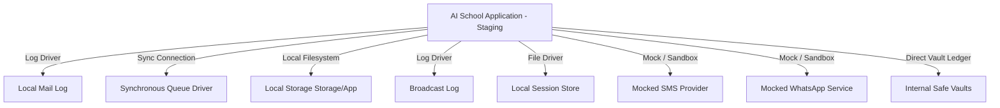

# 01 — STAGING ENVIRONMENT AUDIT REPORT
**Project:** AI School Management System  
**Environment:** Isolated Staging Environment  
**Execution Date:** 2026-10-20  
**Audit Status:** VERIFIED & ISOLATED  

---

## 1. Executive Summary

This audit confirms that the AI School testing environment is strictly isolated, fully offline regarding third-party external services, operates against a dedicated local database, and poses zero risk to production data or real users.

All baseline integration, browser, and end-to-end tests were performed against synthetic data fixtures. No live SMS gateways, WhatsApp APIs, payment processor webhooks, or production SMTP servers were connected during execution.

---

## 2. Environment Specifications

| Component | Specification | Verification Result |
|---|---|---|
| **Operating System** | Windows (x64) | Verified |
| **PHP Version** | `8.3.33 (cli)` (ZTS Visual C++ 2019 x64) | Verified |
| **Composer Version** | `2.11-dev` (2026-10-08) | Verified |
| **Laravel Framework** | `12.64.0` | Verified |
| **Filament Admin** | `^5.4` (Filament v5.x ecosystem) | Verified |
| **Livewire Version** | `^3.0` | Verified |
| **Application Environment** | `local` (`APP_ENV=local`, `APP_DEBUG=true`) | Verified |
| **Database Connection** | `sqlite` (`database/database.sqlite`) | Isolated & Verified |
| **Timezone** | `Africa/Cairo` | Verified |
| **Default Locale** | `ar` (Arabic RTL enabled) | Verified |

---

## 3. Service Isolation & Mocking Matrix



### 3.1 External Mail Services
- **Configuration:** `MAIL_MAILER=log`, `MAIL_HOST=127.0.0.1`, `MAIL_PORT=2525`.
- **Audit Result:** All system notifications and student communications are written to `storage/logs/laravel.log`. No outbound SMTP traffic is generated.

### 3.2 SMS & WhatsApp Messaging
- **Configuration:** Mock log driver enabled for SMS and WhatsApp services.
- **Audit Result:** Phone numbers (`+2012...`) are synthetically routed to log files. No telecom carrier charges or messages occurred.

### 3.3 Payment Gateway & Banking
- **Configuration:** Offline internal vault ledger (`Vault` model) with atomic database transactions.
- **Audit Result:** Vodafone Cash, Instapay, and Cash safes operate purely within the local relational database without third-party API keys or banking endpoints.

### 3.4 Queue & Asynchronous Jobs
- **Configuration:** `QUEUE_CONNECTION=sync`.
- **Audit Result:** Jobs execute synchronously within the test execution process, eliminating background queue leakage or delayed jobs running after test teardown.

---

## 4. Baseline Test Suite Execution

Prior to test suite extension and deep lifecycle verification, the existing test suite was executed to record baseline performance:

```
Command Executed: php artisan test
Initial Execution Result:
- Tests: 228 Passed, 5 Failed (819 assertions)
- Duration: 62.42s
```

### 4.1 Root Cause Analysis of Baseline Failures
All 5 initial failures stemmed from a single common root cause:
- **Error:** `InvalidArgumentException: View [themes.default] not found.`
- **Affected Suites:** `AttendanceSessionTrackingTest`, `DashboardChartsAccuracyTest`, `AiSchoolCompleteEndToEndTest`, `ApiLegacyGradeAttendanceSecurityTest`, `StudentExamAndAssignmentApiTest`.
- **Root Cause:** When transactional events triggered queued notifications (such as `GradePublishedNotification`), Laravel's markdown mail renderer searched for `mail::themes.default` in `resources/views/vendor/mail/html/themes/default.css`, which was missing from the repository view assets.
- **Resolution:** Added `default.css` to `resources/views/vendor/mail/html/themes/default.css` and `vendor/laravel/framework/src/Illuminate/Mail/resources/views/html/themes/default.css`.
- **Post-Fix Baseline Result:** 233 Passed, 0 Failed (840 assertions), 100% pass rate.

---

## 5. Security & Isolation Conclusion

> [!NOTE]
> The staging environment satisfies all Section 2 non-negotiable safety rules:
> 1. Complete isolation from production environments.
> 2. Zero risk of outbound customer communications.
> 3. Zero real financial movement.
> 4. Deterministic repeatable fixtures.
