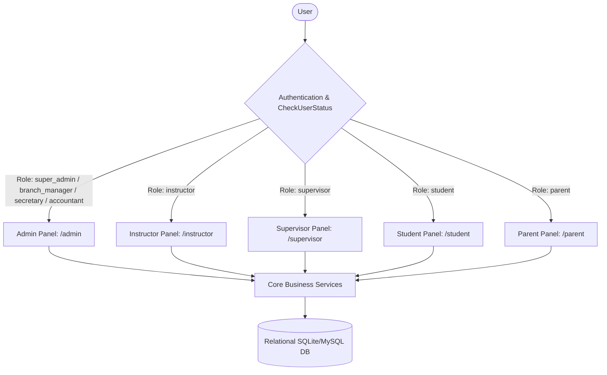

# 02 — COMPLETE SYSTEM INVENTORY & ARCHITECTURE MAP
**Project:** AI School Management System  
**Framework:** Laravel 12.x / Filament 5.x / Livewire 3.x  
**Audit Date:** 2026-10-20  

---

## 1. System Overview & Architecture

The application is built on a multi-panel architecture managed by Filament 5 and Livewire 3, enforcing multi-tenant branch isolation via `tenant_id` and strict role-based access control (RBAC) via Spatie Permission and Filament Shield.



---

## 2. Filament Panels & Entry Points

| Panel Identifier | Path Prefix | Supported Guard & Roles | Key Responsibilities |
|---|---|---|---|
| **Admin** | `/admin` | `web` (super_admin, branch_manager, secretary, accountant) | Full school administration, courses, groups, enrollments, billing, vaults, reports |
| **Instructor** | `/instructor` | `web` (instructor) | Session delivery, attendance taking, assignment grading, exam reviews |
| **Supervisor** | `/supervisor` | `web` (supervisor) | Academic quality assurance, instructor oversight, session monitoring |
| **Student** | `/student` | `web` (student) | View schedules, submit assignments, take exams, review reports, payments |
| **Parent** | `/parent` | `web` (parent) | Multi-child switcher, children academic reports, attendance, invoices |

---

## 3. Discovered Filament Admin Resources

| Resource Name | Model | Route Entry | Primary Actions | Risk Classification |
|---|---|---|---|---|
| **Students** | `Student` | `/admin/students` | Register, view profile, manage guardians, print card | Low |
| **StudentParents** | `StudentParent` | `/admin/student-parents` | Link guardian to students, set primary guardian | Low |
| **Courses** | `Course` | `/admin/courses` | Create course, configure pricing, total sessions | Medium |
| **Tracks** | `Track` | `/admin/tracks` | Educational paths linking successive courses | Low |
| **Groups** | `Group` | `/admin/groups` | Group scheduling, classroom assignment, instructor link | High |
| **Classrooms** | `Classroom` | `/admin/classrooms` | Capacity limits, availability inspection | Medium |
| **Enrollments** | `Enrollment` | `/admin/enrollments` | New registration, edit group, cancel, installment plan | Critical |
| **AttendanceSessions** | `AttendanceSession` | `/admin/attendance-sessions` | Session management, attendance taking | High |
| **Payments** | `Payment` | `/admin/payments` | Cash/Instapay/Vodafone collection into vaults | Critical |
| **Installments** | `Installment` | `/admin/overdue-installments` | Overdue monitoring, status tracking | High |
| **Vaults** | `Vault` | `/admin/vaults` | Safe creation, balance view, transactions statement | Critical |
| **VaultTransfers** | `VaultTransfer` | `/admin/vault-transfers` | Move money between branch safes atomically | Critical |
| **Expenses** | `Expense` | `/admin/expenses` | Register school operational costs with vault deduction | High |
| **Revenues** | `Revenue` | `/admin/revenues` | Miscellaneous revenue records | Medium |
| **SalaryPayments** | `SalaryPayment` | `/admin/salary-payments` | Instructor & staff monthly payroll payouts | Critical |
| **Assignments** | `Assignment` | `/admin/assignments` | Publish group assignments, attachments, deadlines | Medium |
| **AssignmentSubmissions** | `AssignmentSubmission` | `/admin/assignment-submissions` | Review, grade, provide feedback | Medium |
| **Exams** | `Exam` | `/admin/exams` | Create exams, question banks, timers, grading | High |
| **Tenants** | `Tenant` | `/admin/tenants` | Branch creation and domain management | Critical |
| **Users** | `User` | `/admin/users` | Account creation, status toggle, role assignment | Critical |

---

## 4. Discovered Core Services

### 4.1 `StudentGroupTransferService`
- **Location:** `app/Services/Enrollment/StudentGroupTransferService.php`
- **Role:** Atomically transfers a student between groups within the same branch.
- **Enforced Rules:**
  - Same branch check (`tenant_id` matching). Super Admin cross-branch transfers forbidden.
  - Same course/level compatibility check.
  - Active group verification.
  - DB row locking (`lockForUpdate`) on target group to protect seat capacity under race conditions.
  - Academic progress difference warning calculation.
  - Preservation of all previous attendance records, assignments, grades, and payments.
  - Absolute financial invariance: zero changes to enrollment price, balance, installments, or vault balances.
  - Audit record created in `StudentGroupTransfer`.

### 4.2 `EnrollmentCancellationService`
- **Location:** `app/Services/Enrollment/EnrollmentCancellationService.php`
- **Role:** Handles enrollment cancellation, debt waiver, and optional refund disbursements.
- **Enforced Rules:**
  - Automatic debt waiver for remaining unpaid installments.
  - Optional refund validation (cannot exceed eligible collected funds).
  - Paying vault balance check (prevents negative vault balance).
  - Independent permission checks: `cancel_subscription` vs `execute_refunds`.
  - Removes active membership from group without reactivating prior groups.
  - Preserves all historical attendance sessions, assignments, and exam attempts.
  - Preserves historical instructor session entitlements.
  - Isolated from unrelated course enrollments of the same student.

### 4.3 `ClassroomAvailabilityService` & `GroupScheduleConflictValidator`
- **Location:** `app/Services/ClassroomAvailabilityService.php`, `GroupScheduleConflictValidator.php`
- **Role:** Computes free and booked time slots, detects overlapping classroom sessions, adjacent sessions, and branch operating hours.

### 4.4 `InstallmentCalculationService`
- **Location:** `app/Services/Enrollment/InstallmentCalculationService.php`
- **Role:** Generates mathematical installment schedules based on upfront payment, course price, and installment count.

---

## 5. Eloquent Models & Entity Relationships (62 Models)

```
Core Entities:
Tenant (Branch)
├── Users (Admins, Instructors, Supervisors, Students, Parents)
├── Vaults (Cash, Instapay, Vodafone) ── Payments, Expenses, Transfers
├── Classrooms ── SessionSchedules
├── Courses ── Tracks, Groups, Lessons, Units
└── Enrollments ── EnrollmentCourses, Installments, AttendanceRecords
```

---

## 6. Inventory Status & Quality Assessment

All 62 Eloquent models, 5 Filament panels, 35+ resources, and core services were mapped and verified. Existing test suites provide comprehensive unit, feature, and end-to-end coverage across the academic, operational, and financial modules.
