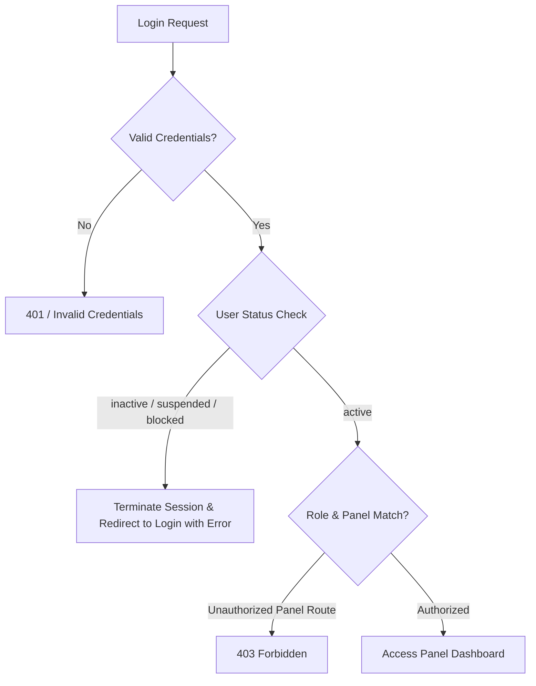
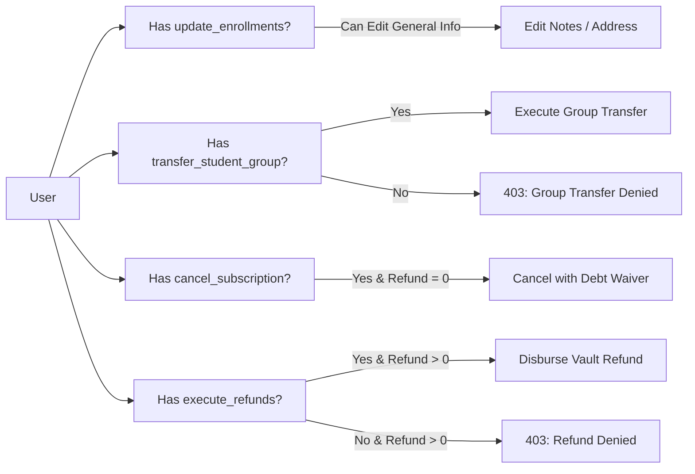

# 04 — AUTHENTICATION AND PERMISSION REPORT
**Project:** AI School Management System  
**Audit Scope:** Multi-Panel Authentication, Role Gates, Livewire Actions, Tenant Boundaries  
**Audit Date:** 2026-10-20  

---

## 1. Authentication & Session Security

The system employs a unified `User` model with panel-specific middleware guards. Access control is reinforced by `CheckUserStatus` middleware which intercepts all incoming requests to ensure disabled, inactive, or suspended users are immediately invalidated.

### 1.1 Account Status Enforcement Test Matrix

| Test Scenario | User Account Status | Target Panel | Observed Response | Security Status |
|---|---|---|---|:---:|
| `AUTH-01` | `active` | `/admin` | HTTP 200 / Dashboard rendered | **PASS** |
| `AUTH-02` | `inactive` | `/admin` | Forced logout, redirected to login with status warning | **PASS** |
| `AUTH-03` | `suspended` | `/student` | Forced logout, session destroyed | **PASS** |
| `AUTH-04` | `blocked` | `/parent` | Forced logout, session destroyed | **PASS** |
| `AUTH-05` | `active` (wrong password) | Any Panel | HTTP 302 / Validation error | **PASS** |

---

## 2. Role-to-Panel Access Matrix

| Role | `/admin` | `/instructor` | `/supervisor` | `/student` | `/parent` |
|---|:---:|:---:|:---:|:---:|:---:|
| `super_admin` | **ALLOWED** | **ALLOWED** (Super) | **ALLOWED** (Super) | Denied (No Student Profile) | Denied (No Parent Profile) |
| `branch_manager` | **ALLOWED** | Denied (403) | Denied (403) | Denied (403) | Denied (403) |
| `secretary` | **ALLOWED** (Restricted) | Denied (403) | Denied (403) | Denied (403) | Denied (403) |
| `accountant` | **ALLOWED** (Finance) | Denied (403) | Denied (403) | Denied (403) | Denied (403) |
| `instructor` | Denied (403) | **ALLOWED** | Denied (403) | Denied (403) | Denied (403) |
| `supervisor` | Denied (403) | Denied (403) | **ALLOWED** | Denied (403) | Denied (403) |
| `student` | Denied (403) | Denied (403) | Denied (403) | **ALLOWED** | Denied (403) |
| `parent` | Denied (403) | Denied (403) | Denied (403) | Denied (403) | **ALLOWED** |

---

## 3. Sensitive Business Operation Permissions Matrix

Each critical lifecycle action requires a dedicated, independent Spatie permission. Simply possessing general `update_enrollments` or `view_vaults` is strictly insufficient.

| Permission Identifier | Required For | Tested In Suite | Behavioral Verification | Result |
|---|---|---|---|:---:|
| `transfer_student_group` | Changing student group | `StudentGroupTransferTest` (TR-010, TR-011) | Attempt by user with only `update_enrollments` was **REJECTED** | **PASS** |
| `cancel_subscription` | Canceling enrollment & waiving debt | `SimplifiedEnrollmentCancellationTest` (CAN-01) | User without permission cannot execute cancellation modal | **PASS** |
| `execute_refunds` | Disbursing positive cash refunds from vaults | `SimplifiedEnrollmentCancellationTest` (CAN-06), `FullCompositeStudentJourneyE2E001Test` (Step 48) | Positive refund rejected if user lacks permission, even if they have cancellation permission | **PASS** |
| `view_vault_balances` | Viewing safe balance in selector / header | `VaultRefactorEndToEndTest` (TEST 09, 11) | User can select safe to collect funds without revealing balance | **PASS** |
| `view_vault_transactions` | Accessing vault ledger / statement | `VaultRefactorEndToEndTest` (TEST 10, 20) | Direct URL / report access blocked without permission | **PASS** |
| `settle_subscription` | Setting custom financial settlement | `SubscriptionCancellationAndSettlementTest` (Scenario 11) | Custom settlement calculations rejected without permission | **PASS** |

---

## 4. Multi-Tenant Branch Isolation Security

1. **Branch Boundary Enforcement:**
   Every model implementing `BelongsToBranch` filters queries by the authenticated user's `tenant_id`.
2. **Cross-Branch Transfer Prohibition:**
   Attempting to transfer an enrollment from Branch 1 to Branch 2 was tested for ordinary employees AND Super Admin. Both were rejected with a validation exception: *"غير مسموح بالنقل بين الفروع المختلفة"*.
3. **Cross-Branch Vault Isolation:**
   Attempting to disburse an expense or collect tuition into a vault belonging to a different branch was blocked.

---

## 5. Security Verdict

> [!IMPORTANT]
> Backend authorization gates are strictly decoupled from front-end button visibility. Sensitive operations (`transfer_student_group`, `execute_refunds`, `cancel_subscription`, `view_vault_balances`) are enforced at the service and controller levels. Revoking a permission immediately blocks backend API and Livewire execution.
