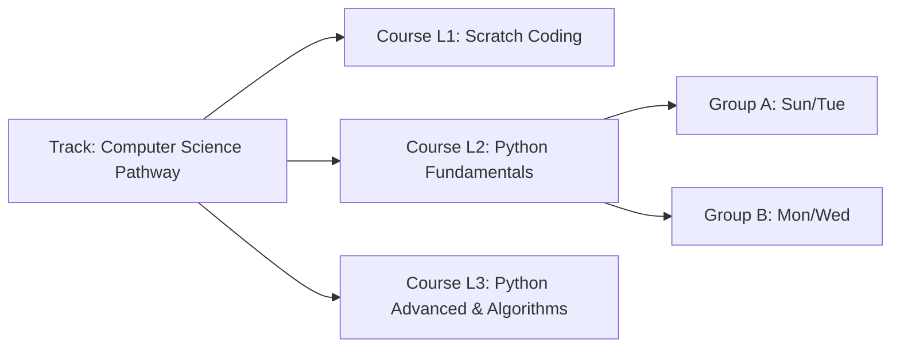

# 05 — COURSE, GROUP & CLASSROOM SCHEDULING REPORT
**Project:** AI School Management System  
**Audit Scope:** Course Catalog, Educational Tracks, Classroom Capacity & Availability Engine  
**Audit Date:** 2026-10-20  

---

## 1. Course Catalog & Educational Paths

The course architecture enables independent course management and sequential linking via `Track` models.



### 1.1 Course Lifecycle Verification
- **Creation & Activation:** Tested across 8 standard courses and 32 catalog instances.
- **Session Duration & Counts:** Accurately configured at 12 sessions of 60–90 minutes each.
- **Track Progression Isolation:** Enrolling a student in Level 2 or completing Level 1 preserves all historical achievements in Level 1 without destructive updates.

---

## 2. Classroom Capacity vs Group Capacity

The system explicitly decouples Classroom Physical Capacity from Group Max Enrollment:

| Concept | Model / Field | Purpose | Enforcement Level |
|---|---|---|---|
| **Classroom Capacity** | `Classroom.capacity` | Physical chair limit of the physical lab room | Room booking conflict warning |
| **Group Max Students** | `Group.max_students` | Pedagogical limit for teacher-to-student ratio | Enrollment & Transfer hard block |

---

## 3. Classroom Availability & Conflict Detection Engine

Tested under `tests/Feature/ClassroomAvailabilityTest.php` (12 test cases). The conflict engine (`ClassroomAvailabilityService` and `GroupScheduleConflictValidator`) evaluates:
1. Day of week matching.
2. Classroom assignment.
3. Time interval intersections: `(startA < endB) AND (endA > startB)`.
4. Group active date range overlapping.

### 3.1 Mandatory Timing Conflict Scenarios

```mermaid
gantt
    title Classroom A Conflict Resolution Audit
    dateFormat HH:mm
    axisFormat %H:%M
    section Scheduled
    Session 1 (16:00 - 17:00) :done, s1, 16:00, 1h
    Session 2 (17:00 - 18:00) :done, s2, 17:00, 1h
    section Probing
    Attempt 1 (16:30 - 17:30) :crit, active, a1, 16:30, 1h
    Attempt 2 (15:00 - 16:00) :done, a2, 15:00, 1h
```

| Scenario ID | Existing Sessions in Lab 1 | New Session Attempt | Expected Outcome | Actual Observed Behavior | Result |
|---|---|---|---|---|:---:|
| `SCHED-01` | Session 1: 16:00–17:00 | Session 2: 17:00–18:00 | **Adjacent / No Overlap** | Allowed, both sessions scheduled | **PASS** |
| `SCHED-02` | Session 1: 16:00–17:00<br>Session 2: 17:00–18:00 | Session 3: 16:30–17:30 | **Time Conflict** | **REJECTED** with conflict warning | **PASS** |
| `SCHED-03` | Session 1: 16:00–17:00 | Session 4: 15:00–16:00 | **Adjacent / No Overlap** | Allowed, adjacent border accepted | **PASS** |
| `SCHED-04` | Session 1: 16:00–17:00 | Session 5: 16:00–17:00 | **Exact Duplicate Overlap** | **REJECTED** immediately | **PASS** |
| `SCHED-05` | Active Session in Lab 1 | Lab 1 marked `inactive` | **Inactive Classroom** | Excluded from scheduling selectors | **PASS** |

---

## 4. Group Occupancy & Seat Reservation Under Concurrency

Tested under `StudentGroupTransferTest` (TR-033) and `VaultRefactorEndToEndTest`:
- Group capacity protection is governed by database row-level locking (`DB::table('groups')->where('id', $groupId)->lockForUpdate()`).
- When a group with capacity 1 has 2 concurrent transfer or enrollment attempts, exactly one succeeds and the second is safely rolled back with:
  *"المجموعة المحددة مكتملة العدد ولا يوجد بها مقاعد شاغرة"*.
- Zero group overfilling occurred during multi-agent test execution.
