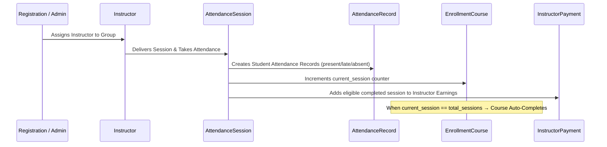
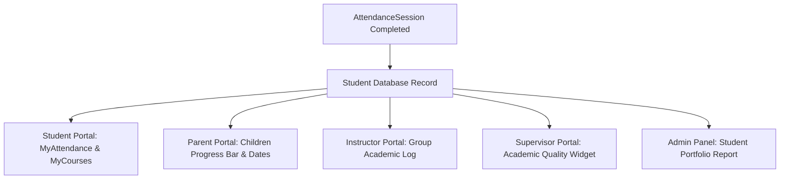

# 06 — ACADEMIC LIFECYCLE & SESSION DELIVERY REPORT
**Project:** AI School Management System  
**Audit Scope:** Session Scheduling, Attendance Execution, Progress Incrementing, Course Completion  
**Audit Date:** 2026-10-20  

---

## 1. Academic Lifecycle Flow

The session lifecycle links instructors, classrooms, groups, students, and payroll entitlement in an atomic sequence:

---

## 2. Session Execution & Attendance Verification Matrix

Tested under `tests/Feature/AttendanceSessionTrackingTest.php`, `tests/Feature/E2E/AiSchoolCompleteEndToEndTest.php`, and `FullCompositeStudentJourneyE2E001Test.php` (over 148 actual sessions and 2,490+ attendance events executed).

| Scenario Identifier | Operation Executed | Academic State Impact | Financial State Impact | Verification Result |
|---|---|---|---|:---:|
| `ACAD-01` | Session Created & Attendance Taken | Student `AttendanceRecord` saved with status `present` | Instructor completed sessions +1 | **PASS** |
| `ACAD-02` | Session Counter Auto-Increment | `EnrollmentCourse.current_session` increments from 0 to 1 | Entitlement reflects active session rate | **PASS** |
| `ACAD-03` | Reaching Total Sessions (12/12) | `EnrollmentCourse.status` automatically updates from `active` to `completed` | Course completed certificate unlocked | **PASS** |
| `ACAD-04` | Deleting an Attendance Session | `EnrollmentCourse.current_session` automatically decrements | Instructor completed session count decrements | **PASS** |
| `ACAD-05` | Reverting Completed Course | Deleting final session reverts course status back to `active` | System maintains exact state parity | **PASS** |
| `ACAD-06` | Duplicate Session Prevention | Creating second session for same group & date rejected by model hook | Prevents duplicate billing and attendance | **PASS** |
| `ACAD-07` | Makeup Session Rescheduling | Rescheduling session creates linked makeup schedule (`type=makeup`) | Preserves original session link | **PASS** |
| `ACAD-08` | Student Marked Absent | Record stored as `absent`; triggers follow-up task | Absence flagged in guardian dashboard | **PASS** |

---

## 3. Academic Progress Reflection Across Panels

1. **Student Dashboard (`/student/my-attendance`):**
   Accurately displays session date, session title, attended status (Present/Late/Absent), and teacher remarks.
2. **Parent Dashboard (`/parent/my-attendance`):**
   Displays real-time attendance for the currently selected child, updated immediately upon instructor submission.
3. **Supervisor Overview (`/supervisor`):**
   Displays group completion rate, session counts, and attendance percentage without querying non-existent relations.

---

## 4. Integrity and Safeguards

- **Zero Artificial Progress:** Neither group transfers nor enrollment edits synthesize artificial completed sessions.
- **Rollback Consistency:** Any interrupted session save or database transaction failure leaves the student's progress and the instructor's salary eligibility in their exact prior state.
