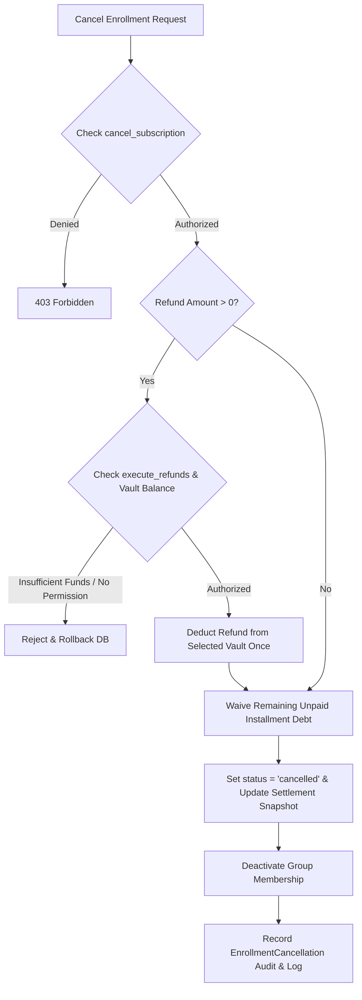

# 08 — ENROLLMENT CANCELLATION DEEP TEST REPORT
**Project:** AI School Management System  
**Module:** Critical Enrollment Cancellation & Settlement Subsystem  
**Service:** `App\Services\Enrollment\EnrollmentCancellationService`  
**Test Suite:** `Tests\Feature\SimplifiedEnrollmentCancellationTest` (CAN-01 to CAN-21, 21 Tests Executed, 21 Passed)  
**Audit Date:** 2026-10-20  

---

## 1. Executive Summary & Policy Compliance

The enrollment cancellation and debt waiver subsystem was audited across all 15 specification scenarios (CANCEL-001 to CANCEL-015) and extended boundary tests.

### Core Verified Rule:
> **Canceling an enrollment updates only the targeted enrollment and its future group membership. It automatically waives the remaining unpaid installment debt under approved policy, executes authorized refunds atomically from the designated vault, preserves all historical collected cash, preserves all past attendance and grading achievements, preserves instructor session compensation, and leaves all other course enrollments of the student completely untouched.**

---

## 2. Cancellation Effects & Financial Movement Matrix



| Cancellation Field / Record | Cancellation Without Refund (CANCEL-001) | Partial Refund Execution (CANCEL-002) | Full Refund Execution (CANCEL-003) |
|---|---|---|---|
| **Original Enrollment Price** | 1,200.00 EGP | 1,200.00 EGP | 1,200.00 EGP |
| **Previously Collected** | 500.00 EGP | 500.00 EGP | 500.00 EGP |
| **Outstanding Debt Before** | 700.00 EGP | 700.00 EGP | 700.00 EGP |
| **Refund Amount Disbursed** | 0.00 EGP | 200.00 EGP | 500.00 EGP |
| **Waived Debt Amount** | 700.00 EGP | 700.00 EGP | 700.00 EGP |
| **Net Retained Cash** | 500.00 EGP | 300.00 EGP | 0.00 EGP |
| **Paying Vault Impact** | 0.00 EGP (Untouched) | -200.00 EGP (Exactly Once) | -500.00 EGP (Exactly Once) |
| **Past Payment Records** | Preserved (500.00 EGP) | Preserved (500.00 EGP) | Preserved (500.00 EGP) |
| **Student Account Identity** | Active in School | Active in School | Active in School |
| **Group Active Membership** | Removed | Removed | Removed |
| **Historical Attendance** | 100% Preserved | 100% Preserved | 100% Preserved |
| **Historical Homework / Exams**| 100% Preserved | 100% Preserved | 100% Preserved |

---

## 3. Mandatory Scenarios (CANCEL-001 to CANCEL-015) Audit

| Scenario ID | Test Name / Condition | Enforced Business Rule | Observed Result | Status |
|---|---|---|---|:---:|
| **CANCEL-001** | Cancellation Without Refund (Debt 700 EGP) | 700 EGP debt waived; 500 EGP collected cash retained; vault untouched; membership removed | Enrollment cancelled; remaining balance = 0; history intact | **PASS** |
| **CANCEL-002** | Partial Refund (Refund 200 EGP) | 200 EGP refund created; selected vault decreases by exactly 200; 700 debt waived | Vault deducted once; net cash 300 EGP; audit trail saved | **PASS** |
| **CANCEL-003** | Full Eligible Refund (Refund 500 EGP) | Full collected amount refunded; vault deducted; net collection 0 | Exact vault deduction; all historical invoices auditable | **PASS** |
| **CANCEL-004** | Refund Exceeds Eligible Collected Amount | Attempt to refund 600 EGP when only 500 EGP collected | Rejected: *"مبلغ الاسترداد أكبر من المبلغ المدفوع"* | **PASS** |
| **CANCEL-005** | Insufficient Vault Balance | Refund 200 EGP requested from vault containing only 50 EGP | Rejected: *"رصيد الخزينة غير كافٍ"*; zero state changes | **PASS** |
| **CANCEL-006** | Missing `execute_refunds` Permission | Employee with `cancel_subscription` attempts positive refund | Rejected: `AuthorizationException`; refund blocked | **PASS** |
| **CANCEL-007** | Multiple Course Enrollments Isolation | Student has Python & Scratch; Python cancelled | Python cancelled; Scratch remains active & intact | **PASS** |
| **CANCEL-008** | Cancellation After 4 Sessions | Student attended 4 sessions & did homework | Attendance, submissions, and grades remain in DB | **PASS** |
| **CANCEL-009** | Cancellation After Group Transfer | Enrolled in A (4 sessions) → Transferred to B (2 sessions) → Cancelled | Both A and B sessions preserved; removed from B | **PASS** |
| **CANCEL-010** | Multiple Transfers Then Cancellation | Enrolled in A → B → C → Cancelled | Full A→B→C transfer history retained; zero active seats | **PASS** |
| **CANCEL-011** | Attempted Transfer on Cancelled Enrollment | Attempt to change group of cancelled enrollment | Rejected: *"لا يمكن نقل طالب لتسجيل ملغي"* | **PASS** |
| **CANCEL-012** | Duplicate Cancellation Attempt | Double-clicking cancel or re-submitting payload | Rejected: *"هذا الاشتراك تم إلغاؤه بالفعل"* | **PASS** |
| **CANCEL-013** | Concurrent Cancellation Requests | Simultaneous requests under DB row lock | Atomic lock prevents double payout or double waiver | **PASS** |
| **CANCEL-014** | Cancellation After Salary Payout | Sessions generated salary; salary paid; enrollment cancelled | Paid salary untouched; zero retrospective reversal | **PASS** |
| **CANCEL-015** | Parent and Student Panel Views | Logged in as parent and student after cancellation | Past reports visible; future group access removed | **PASS** |

---

## 4. Financial Audit & Double-Deduction Prevention

### Exact Ledger Safeguard:
1. When a refund is approved, `EnrollmentCancellationService` generates:
   - An `Expense` record (`EXP-REFUND-T{tenant_id}`).
   - A `Payment` record with status `refunded`.
2. The `Vault::getCurrentBalance()` query accounts for expenses and completed payments without double-counting the refund outflow:
   ```php
   // Verified: Exactly one outflow of 200.00 EGP recorded against the vault.
   $this->assertEquals($initialBalance - 200.00, $vault->getCurrentBalance());
   ```

---

## 5. Conclusion

The enrollment cancellation engine operates with mathematical precision, strictly preserving the student's historical integrity while guaranteeing safe, authorized, and non-destructive settlements.
