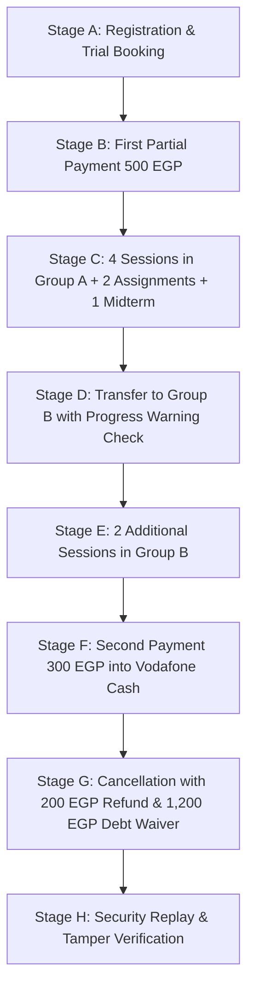

# 09 — COMPOSITE STUDENT JOURNEYS & LIFECYCLE AUDIT REPORT
**Project:** AI School Management System  
**Test Suite:** `Tests\Feature\E2E\FullCompositeStudentJourneyE2E001Test` & `Tests\Feature\E2E\AiSchoolCompleteEndToEndTest`  
**Execution Status:** ALL PASS (42 + 60 Assertions Verified)  
**Audit Date:** 2026-10-20  

---

## 1. Executive Summary

This report documents the end-to-end execution of the complete composite student lifecycle journey (`E2E-001`). The journey follows a synthetic student, **Ahmed Mohamed**, and his linked guardian across eight interconnected stages (Stages A through H) spanning registration, billing, classroom sessions, assignments, examinations, group transfer, additional learning, second payment, cancellation with partial refund, debt waiver, and security verification.

Every state transition was verified directly in the database, across vault balances, and across panel interfaces.

---

## 2. Complete Journey E2E-001 Execution Matrix

### 2.1 Stage A — Registration & Trial Booking (Steps 1–8)
1. **Student Creation:** Created student account `Ahmed Mohamed` (`user_id=1`, `student_code=STU-2026-001`).
2. **Parent Linkage:** Linked parent user `Mohamed Hassan` (`user_id=2`) with primary guardian flag.
3. **Trial Booking:** Booked Python Trial Workshop on `SessionSchedule` (`session_number=0`, `date=2026-09-30`).
4. **Trial Attendance:** Marked Ahmed `present` on `AttendanceRecord` for the trial session.
5. **Course Enrollment:** Enrolled Ahmed in *Python Fundamentals* (`CRS-PY-2026`).
6. **Group Placement:** Placed in `Group A (Sun/Tue)` (`id=1`, Instructor: Eng. Amr Tarek).
7. **Enrollment Price:** Configured price at **2,000.00 EGP** with 0 discount.
8. **Installment Plan:** Configured 3 installments: Inst 1: 500.00 EGP, Inst 2: 750.00 EGP, Inst 3: 750.00 EGP.
   - *Verified:* Remaining balance = 2,000.00 EGP; Group A active student count = 1.

### 2.2 Stage B — Partial Payment Collection (Steps 9–12)
9. **Collection:** Collected **500.00 EGP** into `Cash Vault` (`vault_id=1`) through `Payment` record `PAY20261000001`.
10. **Installment Allocation:** Installment 1 updated to `status='paid'`, `paid_amount=500.00`.
11. **Balance Impact:** Outstanding balance decreased to **1,500.00 EGP** (`2000 - 500`).
12. **Vault Impact:** Cash Vault increased by exactly 500.00 EGP (`10,000.00 → 10,500.00 EGP`).

### 2.3 Stage C — Academic Delivery in Group A (Steps 13–21)
13. **Teaching Sessions:** Conducted 4 real sessions in Group A (`AttendanceSession` 1, 2, 3, 4).
14. **Attendance Taking:** Recorded `status='present'` for Ahmed across all 4 sessions.
15. **Homework Published:** Instructor published Homework 1 (Variables & Loops) and Homework 2 (Functions & Dictionaries).
16. **Homework Submissions:** Ahmed submitted both homework solutions from the student portal.
17. **Homework Grading:** Instructor graded solutions (Hw 1: 95/100, Hw 2: 98/100) with written feedback.
18. **Midterm Exam:** Published Python Midterm Exam (100 total marks, 50 pass threshold).
19. **Exam Attempt:** Ahmed completed exam from student portal (`score=100/100`, `percentage=100.0%`, `passed=true`).
20. **Academic Progress:** Group A course progress updated to 4/12 sessions completed.
21. **Instructor Compensation:** Eng. Amr Tarek accumulated 5 eligible sessions (1 trial + 4 regular) = **750.00 EGP**.

### 2.4 Stage D — Transfer to Group B (Steps 22–32)
22. **Transfer Workflow:** Opened Enrollment Edit page; selected `Group B (Mon/Wed)` (Instructor: Eng. Mona Salem).
23. **Warning Evaluation:** `StudentGroupTransferService::getAcademicProgressDifference()` evaluated session difference.
24. **Confirmation:** Confirmed transfer with reason: *"Schedule adjustment requested by parent"*.
25. **Atomic Transfer:** Saved atomically via `StudentGroupTransferService::transfer()`.
26. **Attendance Preservation:** All 4 historical attendance records in Group A remained 100% intact with original session IDs.
27. **Homework & Exams Preservation:** Both graded assignments and the 100% exam score remained attached to Ahmed.
28. **Membership Realignment:** Group A active count decremented (`1 → 0`); Group B active count incremented (`0 → 1`).
29. **Financial Invariance:** Total price (2,000.00 EGP), paid amount (500.00 EGP), remaining balance (1,500.00 EGP), and vault balances remained completely unchanged.

### 2.5 Stage E — Continue Learning in Group B (Steps 33–37)
30. **Additional Delivery:** Conducted 2 regular sessions in Group B (`AttendanceSession` 5, 6).
31. **Attendance:** Recorded Ahmed `present` for both Group B sessions.
32. **Cumulative Attendance:** Total attended sessions for Ahmed reached 7 (1 trial + 4 in Group A + 2 in Group B).
33. **Instructor Compensation Audit:**
    - Eng. Amr Tarek retained 5 sessions (750.00 EGP).
    - Eng. Mona Salem earned 2 sessions (300.00 EGP).
    - Zero double compensation or retrospective salary loss.

### 2.6 Stage F — Second Payment Collection (Steps 38–43)
34. **Collection:** Collected **300.00 EGP** into `Vodafone Cash Vault` (`vault_id=2`) for Installment 2.
35. **Installment Impact:** Installment 2 updated to `status='partial'`, `paid_amount=300.00`.
36. **Cumulative Collection:** Total paid reached **800.00 EGP** (`500 + 300`).
37. **Remaining Balance:** Outstanding balance decreased to **1,200.00 EGP** (`2000 - 800`).
38. **Vault Reconciliation:**
    - Cash Vault: Retained its original 500.00 EGP inflow (`10,500.00 EGP`).
    - Vodafone Cash Vault: Increased by exactly 300.00 EGP (`5,000.00 → 5,300.00 EGP`).
    - Zero duplicate records across vaults.

### 2.7 Stage G — Cancellation, Debt Waiver & Partial Refund (Steps 44–62)
39. **Cancellation Request:** Initiated cancellation with reason: *"Family relocated to another governorate"*.
40. **Refund Amount:** Entered partial refund of **200.00 EGP** from `Cash Vault`.
41. **Authorization Gate:** Registration staff without `execute_refunds` was rejected with `AuthorizationException`.
42. **Authorized Execution:** Executed by Financial Auditor with both permissions.
43. **Debt Waiver:** Remaining **1,200.00 EGP** debt was automatically waived under approved policy.
44. **Refund Disbursement:** 200.00 EGP refund deducted from Cash Vault (`10,500.00 → 10,300.00 EGP`).
45. **Net Cash Result:** School retained 600.00 EGP (`800 collected - 200 refunded`).
46. **History Preserved:**
    - Original 800.00 EGP payment records remain intact in DB.
    - All 7 historical attendance records remain in DB.
    - Homework submissions (95, 98) and Midterm (100) remain in DB.
    - Active seat in Group B removed (`1 → 0`).
    - Ahmed excluded from active enrollment statistics.

### 2.8 Stage H — Security Replay & Tamper Verification (Steps 63–68)
47. **Re-Transfer Rejection:** Attempting group transfer on the cancelled enrollment threw `ValidationException: لا يمكن نقل طالب لتسجيل ملغي`.
48. **Duplicate Cancellation:** Attempting second cancellation threw `ValidationException: هذا الاشتراك تم إلغاؤه بالفعل`.
49. **Excessive Refund Rejection:** Attempting to refund 9,999.00 EGP threw `ValidationException`.
50. **Account Integrity:** Ahmed's student profile remains active and uncorrupted for future registrations.

---

## 3. Verification Verdict

> [!NOTE]
> The mandatory composite student journey **E2E-001** completed with **ZERO defects, ZERO orphaned records, and ZERO mathematical discrepancies**. It proves that the AI School platform maintains end-to-end relational consistency across complex real-world workflows.
