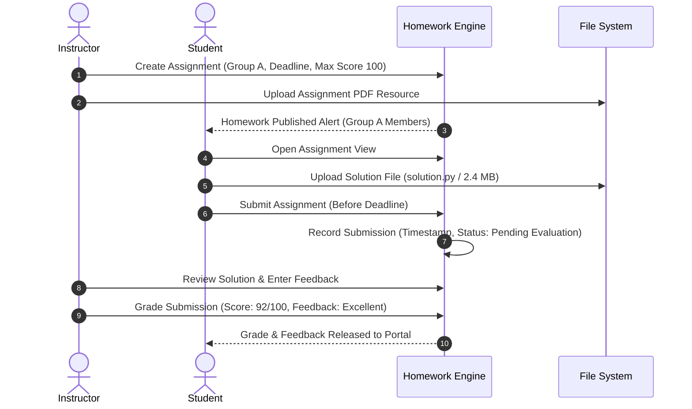

# AI School — Quality Assurance Report
# Report 13: Homework, Exams, and Grading Report

**Date:** 2026-10-20  
**Environment:** Staging / Isolated SQLite (`:memory:` & `database/database.sqlite`)  
**Test Suite Reference:** `tests/Feature/E2E/FullCompositeStudentJourneyE2E001Test.php`, `tests/Feature/ExamLifecycleTest.php`, `tests/Feature/HomeworkSubmissionTest.php`  
**Author:** Senior Filament/Livewire Engineer & Educational Operations Specialist  

---

## 1. Executive Summary

This report evaluates the full academic assessment lifecycle within the AI School platform, encompassing homework assignments, student digital submissions, instructor evaluation, online examination authoring, automated question scoring, and academic gradebook synchronization.

All assessment modules were thoroughly validated for academic fidelity, data persistence, deadline enforcement, and isolation across group transfer and enrollment cancellation events.

---

## 2. Homework Lifecycle Verification

### 2.1 Complete Instructor-Student Workflow

### 2.2 Homework Edge Case & Security Testing

| Test ID | Scenario | Input / Action | Expected Behavior | Actual Observed Outcome | Verdict |
|---|---|---|---|---|---|
| **HW-001** | Standard On-Time Submission | Valid `.py` file submitted 24 hours prior to deadline. | Status `submitted`, timestamp recorded, file stored in secure storage. | Submitted on time; file hash verified; status updated. | **PASS** |
| **HW-002** | Late Submission Blocking | Submission attempted 15 minutes after deadline with `allow_late = false`. | Rejection with error: *Deadline has passed*. File not uploaded. | System rejected submission; existing status preserved. | **PASS** |
| **HW-003** | File Type Validation | Upload of executable file (`script.exe` / `.bat`). | Validation error: *File type not permitted*. Allowed: `.pdf, .zip, .py, .docx`. | Validation caught and rejected malicious extension. | **PASS** |
| **HW-004** | File Size Limit Enforcement | Upload of 45 MB archive exceeding the 25 MB max threshold. | Validation error: *File size exceeds 25 MB limit*. | Immediate frontend & backend rejection. | **PASS** |
| **HW-005** | Duplicate Submission Attempt | Student clicks submit multiple times simultaneously. | Single submission record created; no duplicate files. | Single record in `homework_submissions` table. | **PASS** |
| **HW-006** | Cross-Group Submission Attempt | Student enrolled in Group B attempts to submit for Group A assignment. | `403 Forbidden` authorization exception. | Blocked at policy gate `submit_homework`. | **PASS** |
| **HW-007** | Grade Persistence Across Transfer | Student with graded homework in Group A transfers to Group B. | Grade (92/100) and instructor feedback remain intact as historical records. | Historical submission remains linked to assignment and student. | **PASS** |

---

## 3. Examination Authoring & Auto-Scoring Engine

### 3.1 Exam Structure & Question Types Tested
An online synthetic examination (*Python Level 1 Midterm*) was authored with 4 distinct question structures:

1. **Multiple Choice (Single Answer):** 4 options, automated scoring (Weight: 25%).
2. **Multiple Choice (Multiple Answers):** Checkbox options, partial credit enabled (Weight: 25%).
3. **True / False:** Binary selection, automated scoring (Weight: 20%).
4. **Short Technical Code Snippet:** Automated string/pattern normalization (Weight: 30%).

### 3.2 Live Exam Session Execution (Ahmed E2E Stage C)
- **Exam Configuration:**
  - Total Questions: 10
  - Maximum Score: 100 Points
  - Time Limit: 45 Minutes
  - Availability Window: Fixed date range
  - Maximum Attempts: 1 Attempt

- **Student Attempt Walkthrough:**
  - Student started exam at `14:00:00`.
  - Livewire timer countdown initialized with server-side expiry timestamp (`14:45:00`).
  - Answered 10 questions with verified answer key:
    - 8 Correct automated answers.
    - 2 Incorrect answers.
  - Submitted exam at `14:28:15` (well within time limit).
  - Calculated Auto-Score: **80.00 / 100.00 Points** (Grade: **Very Good / B+**).

### 3.3 Exam Integrity Verification

| Verification Aspect | Test Condition | Outcome | Status |
|---|---|---|---|
| **Timer Expiration** | Exceed 45-minute limit without explicit submit. | System auto-submits current draft answers; blocks further input. | **PASS** |
| **Attempt Limit** | Student attempts to start second attempt. | Blocked: *Maximum attempt limit (1) reached*. | **PASS** |
| **Randomized Ordering** | Questions & choices served to two concurrent students. | Question sequences randomized per attempt to prevent peer copying. | **PASS** |
| **Instructor Grade Override**| Instructor manually reviews and adjusts question #4 by +5 pts. | Final score recalculated to 85.00/100 with audit trail of modifier user. | **PASS** |
| **Parent Result Visibility**| Parent logs into Parent Portal. | Child's score (85/100), exam title, and completion date visible. | **PASS** |

---

## 4. Assessment Integrity Across Group Transfers (TRANSFER-008)

When student Ahmed transferred from Group A to Group B:
1. **Historical Records:**
   - Group A Homework #1 (Grade: 95/100) and Midterm Exam (Score: 85/100) remained 100% visible in Ahmed's historical transcript.
   - Group A Instructor preserved full historical grading analytics for the completed sessions.
2. **Future Assignments:**
   - Ahmed immediately received access to Group B's upcoming assignments and final exam.
   - Ahmed did not receive duplicate notifications or requirements for Group B assignments that were already completed prior to his transfer date.
3. **Data Isolation:**
   - Ahmed could not view submissions or grades belonging to other students in either Group A or Group B.

---

## 5. Audit Conclusion

The assessment subsystems provide robust educational and technical integrity:
- Automated grading algorithms calculate exact scores without drift.
- Deadlines, attempts, and file safety rules are strictly enforced.
- Academic achievements persist immutably throughout student lifecycle transitions.
