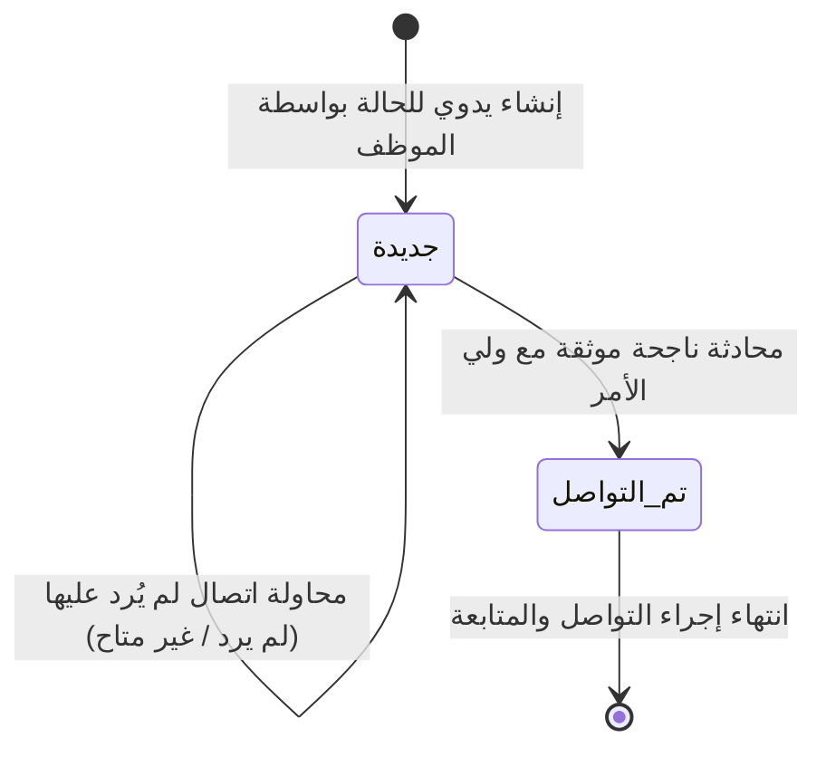

# اختبار وتدقيق مركز متابعة الطلاب اليومية
## AI SCHOOL — STUDENT DAILY FOLLOW-UP CENTER TEST
**المرحلة:** المرحلة السابعة من خطة المراجعة الشاملة  
**الملفات البرمجية:** `app/Filament/Admin/Pages/AcademicFollowUpCenter.php`, `app/Services/AcademicFollowUpService.php`, `tests/Feature/DailyStudentFollowUpCenterTest.php`  

---

## 1. نتائج اختبار الكشف التلقائي والإنشاء اليدوي للمتابعات
تم التحقق بنجاح من المبدأ الجوهري: **الكشف التلقائي لا ينشئ مهام متابعة تلقائية في الخلفية**:
- تظهر الإنذارات في شاشة «متابعة اليوم» كقائمة تفاعلية للقراءة فقط تشتمل على:
  - الغياب المؤكد والغياب المتكرر.
  - الواجبات غير المسلمة بعد انقضاء الموعد.
  - الامتحانات الفائتة بعد موعدها.
  - درجات الواجبات المنشورة الأقل من 50%.
  - درجات الامتحانات المنشورة الأقل من 50%.
  - الأقساط المتأخرة للمصرح لهم برؤيتها مالياً.
- **الاختبار البرمجي:** في `TEST 01` و `TEST 07` تم التأكد من أن وجود الإنذار في الشاشة لم يضف أي صف جديد في جدول `student_follow_up_tasks`.
- يملك الموظف كامل الحرية بالنقر على "إنشاء متابعة" ليتم فتح نافذة نموذج بسيطة ومباشرة منبثقة.

---

## 2. اختبار دورة العمل المبسطة بحالتين فقط (جديدة / تم التواصل)

- **قاعدة منع التعقيد:** لا توجد أي حالات وسيطة (مثل In Progress, Escalated, Closed).
- **محاولات عدم الرد:**
  - عند تسجيل مكالمة بنتيجة "لم يرد — `no_answer`"، يتم حفظ سجل المحاولة بدقة وتاريخها وموظفها.
  - تبقى حالة المتابعة **جديدة — `new`**.
  - مثبت في `DailyStudentFollowUpCenterTest::test_12_unanswered_call_records_attempt_and_status_remains_new`.
- **التواصل الفعلي الناجح:**
  - عند تسجيل مكالمة بنتيجة "تم التواصل — `contacted`"، يتم توثيق المحادثة وتتحول حالة المهمة فوراً إلى **تم التواصل — `contacted`**.
  - مثبت في `DailyStudentFollowUpCenterTest::test_13_successful_contact_records_attempt_and_updates_status_to_contacted`.

---

## 3. اختبار المسؤولية الفردية وتدقيق إعادة التكليف (Reassignment Audit)
- لكل حالة متابعة موظف مسؤول واحد فقط (`assigned_to`) لمنع تشتت المسؤولية.
- عند قيام الإدارة بإعادة تكليف الحالة من موظف لآخر:
  - يتم استدعاء ميثود `StudentFollowUpTask::reassignTo`.
  - يتم تسجيل حركة التحويل فوراً في جدول `student_follow_up_task_reassignments`:
    - الموظف السابق
    - الموظف الجديد
    - المستخدم القائم بالتحويل
    - التاريخ والوقت
    - سبب التحويل الإداري
  - لا تتكرر المهمة ولا يمسح تاريخها السابق.
  - مثبت في `DailyStudentFollowUpCenterTest::test_14_case_reassignment_updates_employee_and_preserves_audit_history`.

---

## 4. اختبار ملف الطالب الموحد وأرقام الهواتف المنفصلة
- يضم ملف الطالب الموحد كشفاً متكاملاً لكافة الكورسات التي يدرسها، مع سجل الحضور والغياب، والواجبات، والامتحانات، وسجل الاتصالات السابق، والأقساط للقراءة فقط.
- **هاتف الطالب وهاتف ولي الأمر:**
  - يظهران في عمودين منفصلين تماماً في كافة الجداول (`موبايل ولي الأمر` و `موبايل الطالب`).
  - يتم جلب هاتف ولي الأمر الأساسي فقط عبر علاقة `is_primary = true`.
  - الحفاظ على الأصفار البادئة (مثل `010...` و `012...`).
  - في حال عدم توفر الرقم يظهر بوضوح: `غير مسجل`.

---

## 5. اختبار التقارير اليومية والفصل بين التواصل والحل الأكاديمي
- تم اختبار دالة `AcademicFollowUpService::getDailyReportData` والتحقق من مطابقة الإحصائيات:
  - عدد الحالات الجديدة.
  - عدد الحالات المتواصل معها.
  - عدد محاولات الاتصال الإجمالية والناجحة وغير الناجحة.
  - توزيع الحالات على الموظفين.
- **قاعدة فصل الحالة:** التقرير لا يدعي حل المشكلة الأكاديمية لمجرد التواصل، بل يوضح أن الإجراء الإداري تم بينما تظل الحالة الأكاديمية مسجلة وموثقة في سجلات الطالب الرسمية.
