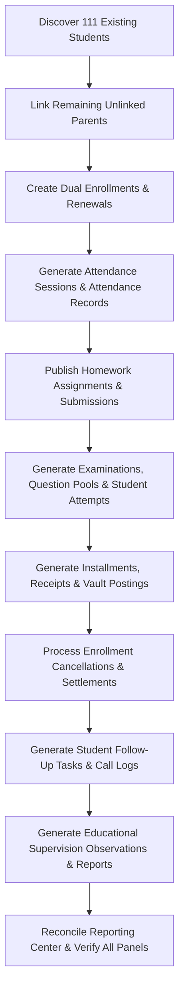

# 03 — Data Population Plan & Architecture

## Overview
This document specifies the technical design, architectural patterns, and execution flow of the persistent database population engine built for the AI School platform.

---

## 1. Core Principles & Design Objectives

1. **Zero Dummy Student Creation**:
   The engine strictly reuses the 111 existing students discovered in `students` table.
2. **Relational Coherence**:
   No orphan records or impossible states. For example:
   - A student only has attendance in sessions belonging to a group they are enrolled in.
   - An exam attempt is linked to an existing exam, question pool, and enrolled student.
   - Installments and receipts strictly balance against the course tuition minus approved discounts.
3. **Domain Service & Model Compliance**:
   All database writes respect table constraints, SQLite check constraints (`CHECK (status IN (...))`), unique compound keys, and foreign keys.
4. **Auditability & Traceability**:
   Every generated demo record carries the tag `AI_SCHOOL_PERSISTENT_DEMO` in its metadata, notes, or description.
5. **Idempotence & Cleanup Capability**:
   The command [PopulateExistingStudentsDemoData.php](file:///d:/ai_school_new-main%20%281%29/ai_school_new-main/app/Console/Commands/PopulateExistingStudentsDemoData.php) can be run safely multiple times with `--dry-run` or cleaned up with `--cleanup`.

---

## 2. Command Architecture & Options

The command was registered in the Artisan kernel under:
```bash
php artisan ai-school:populate-demo-data {--dry-run} {--cleanup}
```

### Supported Flags:
- `--dry-run`: Previews existing counts, targets, and expected record creations without writing to the database.
- `--cleanup`: Safely purges only records containing the `AI_SCHOOL_PERSISTENT_DEMO` marker in reverse dependency order, leaving all pre-existing genuine school data completely untouched.

---

## 3. Step-by-Step Execution Sequence



### Phase Breakdown:
1. **Parent Portal Connectivity**:
   Ensured all 111 students have an associated user with the `parent` role via `parent_student` pivot records.
2. **Academic Structure & Enrollments**:
   Created 10 dual enrollments across alternate courses and 10 renewal terms across next-level groups, respecting the `UNIQUE(student_id, group_id)` constraint.
3. **Sessions & Attendance**:
   Generated 156 attendance sessions across 4 major groups covering historical (past 6 weeks) and upcoming (next 2 weeks) sessions. Generated 375 detailed attendance records with realistic statuses (Present, Absent, Late).
4. **Homework & Assignments**:
   Created 39 assignments with valid deadlines, instructions, and max points; generated 125 student submissions with realistic grading and feedback notes.
5. **Examinations & Attempts**:
   Created 39 examinations, 78 questions (Multiple Choice & True/False), 125 attempts, and 125 graded records showing a realistic grade curve (A+, C, F).
6. **Financial Operations & Treasury**:
   Created 66 installments, 33 official receipts with vault postings, 12 cancellation settlements with refund liabilities, operational expenses, revenues, and vault transfers.
7. **Follow-Up & Supervision**:
   Generated academic follow-up tasks (answered vs. unanswered contact logs) and supervisory observations, monthly instructor evaluations, resolved appeals, and periodic supervision reports.
