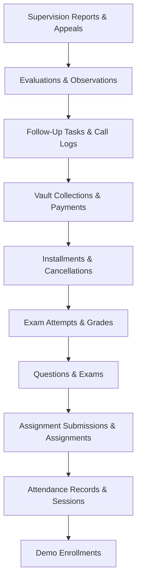

# 15 — Demo Data Cleanup Plan & Rollback Protocol

## Overview
This document specifies the rollback procedures, administrative cleanup commands, and safety protocols available to reset or purge the demonstration records without endangering original school data.

---

## 1. Safety Guarantees & Non-Destructive Invariants

Any cleanup operation executed on this system strictly adheres to the following rules:
1. **Preservation of Authentic Students**:
   The 111 pre-existing students in `students` are **never touched or deleted**.
2. **Tag-Targeted Purge**:
   Only records matching the `AI_SCHOOL_PERSISTENT_DEMO` marker are eligible for deletion.
3. **Strict Production Shield**:
   The cleanup command automatically checks `app()->environment()` and aborts immediately if executed against an environment marked `production`.
4. **Referential Integrity Ordering**:
   Deletion occurs in strict reverse topological dependency order to avoid foreign key constraint violations.

---

## 2. Option A: Automated CLI Cleanup

An administrative command option is built directly into the population tool:

```bash
php artisan ai-school:populate-demo-data --cleanup
```

### Execution Order:


---

## 3. Option B: Cold Backup Restore (Instant Hard Reset)

In the event of a required complete instantaneous rollback to the exact state prior to this demonstration run:

1. **Stop Application Web Server**:
   ```bash
   # Terminate dev server process
   ```
2. **Restore SQLite Database File**:
   ```bash
   cp database/database.sqlite.pre_demo_population_backup database/database.sqlite
   ```
3. **Verify Integrity & Restart Server**:
   ```bash
   php artisan migrate:status
   php artisan serve
   ```
   *The database immediately reverts to its exact pre-population state with zero residue.*
