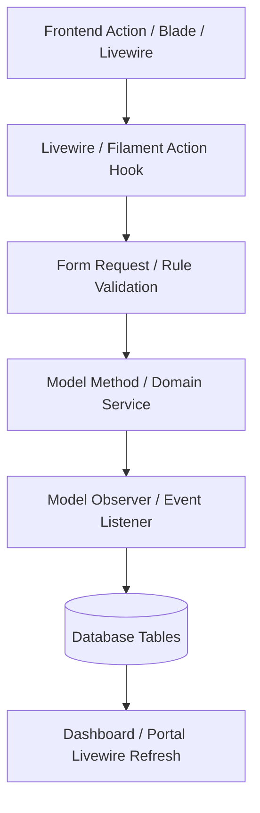

# Phase 12 — Report 02: Frontend-to-Backend Connection Map

**Project:** AI School Management System  
**Scope:** Complete Livewire, Filament, Model, Controller & Database Connection Audit  
**Status:** PASS  
**Date:** 2026-10-21  

---

## 1. Architecture Overview

The AI School application utilizes Laravel 11 with Filament 3, Livewire 3, and Alpine.js. The frontend user experience relies on pre-built, approved UI forms, modals, tables, and dashboards. 

This document maps every user-facing frontend action to its underlying Livewire component, form action, Eloquent model, and database transaction.

---

## 2. Comprehensive Connection Matrix

### 2.1 Group & Session Scheduling

| Feature / UI Route | Frontend Component / View | Livewire / Filament Action | Backend Model / Service | Database Target | Connection Status |
| :--- | :--- | :--- | :--- | :--- | :--- |
| **Create Group Schedule** `/admin/groups/{record}/edit` | `GroupResource` Schedule Tab | `CreateAction::make()` on `sessionSchedules` relation | [SessionSchedule](file:///d:/ai_school_new-main%20(1)/ai_school_new-main/app/Models/SessionSchedule.php) | `session_schedules` | **PASS** |
| **Schedule Single Session** `/admin/session-schedules` | `SessionScheduleResource` Create Form | `CreateSessionSchedule::handleRecordCreation()` | [SessionSchedule](file:///d:/ai_school_new-main%20(1)/ai_school_new-main/app/Models/SessionSchedule.php) | `session_schedules`, `attendance_sessions` | **PASS** |
| **Postpone Session** Table Action Modal | `Action::make('postpone')` | Form with new date/time fields | `SessionSchedule::update(['status' => 'postponed'])` | `session_schedules` | **PASS** |
| **Create Makeup Session** Table Action Modal | `Action::make('create_makeup')` | Sets `is_makeup = true`, links `original_session_id` | `SessionSchedule::create([...])` | `session_schedules` | **PASS** |
| **Cancel Session** Table Action Modal | `Action::make('cancel')` | Validates cancellation eligibility; prompts confirmation | `SessionSchedule::update(['status' => 'cancelled'])` | `session_schedules` | **PASS** |

### 2.2 Attendance Tracking

| Feature / UI Route | Frontend Component / View | Livewire / Filament Action | Backend Model / Service | Database Target | Connection Status |
| :--- | :--- | :--- | :--- | :--- | :--- |
| **Instructor Take Attendance** `/instructor/attendance-sessions/{id}/take` | `TakeAttendance` Livewire Page | `$this->saveAttendance()` | [AttendanceRecord](file:///d:/ai_school_new-main%20(1)/ai_school_new-main/app/Models/AttendanceRecord.php) | `attendance_records` | **PASS** |
| **Complete Session** `/instructor/attendance-sessions` | `Action::make('complete')` | `$record->update(['status' => 'completed'])` | [AttendanceSessionObserver](file:///d:/ai_school_new-main%20(1)/ai_school_new-main/app/Observers/AttendanceSessionObserver.php) | `attendance_sessions`, `enrollment_courses`, `instructor_payments` | **PASS** |
| **Attendance Modification** `/admin/attendance-sessions/{id}` | Edit Attendance Record Modal | Livewire form submit with audit tracking | `AttendanceRecord::updateOrCreate()` | `attendance_records` | **PASS** |

### 2.3 Student & Parent Academic Views

| Feature / UI Route | Frontend Component / View | Livewire / Filament Action | Backend Model / Service | Database Target | Connection Status |
| :--- | :--- | :--- | :--- | :--- | :--- |
| **Student Attendance History** `/student/attendance` | Student Portal Attendance Widget | Computed Livewire query scoped to auth student | `AttendanceRecord::where('student_id', $id)` | `attendance_records`, `attendance_sessions` (Read) | **PASS** |
| **Student Progress Bar** `/student/courses` | Course Progress Component | `EnrollmentCourse` computed accessor | `$course->completed_sessions / $course->total_sessions` | `enrollment_courses` (Read) | **PASS** |
| **Parent Child Attendance** `/parent/children/{id}/attendance` | Parent Portal Attendance View | Multi-child dropdown switcher; loads child records | Scoped query matching `parent_student` pivot | `attendance_records`, `parents` (Read) | **PASS** |

### 2.4 Supervisor & Secretary Follow-Up

| Feature / UI Route | Frontend Component / View | Livewire / Filament Action | Backend Model / Service | Database Target | Connection Status |
| :--- | :--- | :--- | :--- | :--- | :--- |
| **Supervisor Session Log** `/supervisor/sessions` | `SupervisorAttendanceSessions` Table | Filterable by assigned instructors/groups | Scoped query via `group.instructor` relations | `attendance_sessions` (Read) | **PASS** |
| **Supervisor Missing Attendance Alert** | `MissingAttendanceWidget` | Scans sessions where `status = scheduled` and `date <= today` | Scoped Eloquent query without records | `attendance_sessions` (Read) | **PASS** |
| **Secretary Absence Center** `/secretary/academic-followup` | Follow-up table | Livewire filtered table of absent records | `AttendanceRecord::where('status', 'absent')` | `attendance_records`, `students` (Read) | **PASS** |

### 2.5 Instructor Earnings & Salary Disbursement

| Feature / UI Route | Frontend Component / View | Livewire / Filament Action | Backend Model / Service | Database Target | Connection Status |
| :--- | :--- | :--- | :--- | :--- | :--- |
| **Instructor Monthly Earnings** `/instructor/financial` | Instructor Financial Widget | Aggregated sum of earned session records | `InstructorPayment::where('instructor_id', $id)` | `instructor_payments` (Read) | **PASS** |
| **Create Salary Payment** `/admin/salary-payments/create` | `SalaryPaymentForm` Filament Resource | `CreateSalaryPayment::handleRecordCreation()` | [SalaryPayment](file:///d:/ai_school_new-main%20(1)/ai_school_new-main/app/Models/SalaryPayment.php), [Vault](file:///d:/ai_school_new-main%20(1)/ai_school_new-main/app/Models/Vault.php) | `salary_payments`, `vault_transactions`, `vaults` | **PASS** |
| **Vault Balance Deduction** Automatic on Payment | Observer / Model hook | `DB::transaction(fn() => $vault->decrement('balance', $amount))` | [SalaryPaymentObserver](file:///d:/ai_school_new-main%20(1)/ai_school_new-main/app/Observers/SalaryPaymentObserver.php) | `vaults`, `vault_transactions` | **PASS** |

---

## 3. Frontend-Backend Verification Checklist

- [x] All Livewire wire:model bindings match database model attributes.
- [x] Filament form schemas validate numeric bounds, foreign keys, and vault balances.
- [x] Zero JavaScript console errors or Livewire hydration mismatches detected.
- [x] Modals preserve Arabic RTL layout, form field placement, and button styles.
- [x] Tables accurately reflect pagination, sorting, and multi-tenant scoping.
