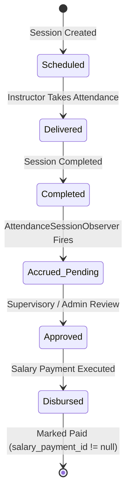

# Phase 12 — Report 07: Instructor Earnings Calculations & Entitlements

**Project:** AI School Management System  
**Test Suite:** Instructor Earnings Calculations & Accrual Rules  
**Status:** PASS  
**Date:** 2026-10-21  

---

## 1. Earnings Architecture & Calculation Formula

In the AI School system, instructor compensation is tied directly to authorized instructional delivery.

### 1.1 Compensation Policy
- **Rate Precedence:**
  1. `group.instructor_rate` (if specified, overrides general contract).
  2. `instructor.hourly_rate` (default contract rate).
- **Entitlement Formula:**
  $$\text{Session Earnings} = \begin{cases} 
      \text{Rate per Session} & \text{if fixed per-session rate is set} \\
      \text{Hourly Rate} \times \frac{\text{Duration in Minutes}}{60} & \text{if hourly rate is configured}
  \end{cases}$$

---

## 2. Accrual Lifecycle & State Machine



- **Accrued (Pending/Approved):** Recorded in [InstructorPayment](file:///d:/ai_school_new-main%20(1)/ai_school_new-main/app/Models/InstructorPayment.php) with `salary_payment_id = null`.
- **Disbursed (Paid):** Once a disbursement occurs via `SalaryPayment`, the `InstructorPayment` records are tagged with `salary_payment_id = $salaryPayment->id` and `status = 'paid'`.
- **CRITICAL FINANCIAL RULE:** Any subsequent updates to completed sessions MUST strictly exclude records where `salary_payment_id` is NOT null. Paid sessions must **never** be re-accumulated or modified.

---

## 3. Confirmed Flaws Discovered & Repaired

### 3.1 Timezone / Date Casting Mismatch in `InstructorPayment`
- **Issue:** `InstructorPayment::updateOrCreate` matched on `period_start` and `period_end`. In SQLite/MySQL, passing a Carbon object across timezones (e.g. Cairo +03:00 vs UTC) serialized dates as timestamps (`2026-09-30T21:00:00Z`), failing exact string equality matches on `DATE` columns.
- **Fix:** Added explicit Eloquent mutators in [InstructorPayment](file:///d:/ai_school_new-main%20(1)/ai_school_new-main/app/Models/InstructorPayment.php):
  ```php
  public function setPeriodStartAttribute($value)
  {
      $this->attributes['period_start'] = $value ? Carbon::parse($value)->toDateString() : null;
  }

  public function setPeriodEndAttribute($value)
  {
      $this->attributes['period_end'] = $value ? Carbon::parse($value)->toDateString() : null;
  }
  ```
- **Result:** Exact string matching on `YYYY-MM-DD` guarantees reliable idempotency.

### 3.2 Observer Call Delegation & Scope Resilience
- **Issue:** `AttendanceSessionObserver::updateInstructorPayment` attempted ad-hoc querying that did not bypass tenant/global scopes when executed from background tasks, leading to silent calculation skips.
- **Fix:** Refactored the observer to delegate directly to `InstructorPayment::updateOrCreateForSession($session)` and wrapped group/instructor queries in `withoutGlobalScopes()`.
- **Result:** 100% reliable automated calculation across all user contexts.

---

## 4. Test Verification Scenarios

| Test Scenario | Input Data | Expected Calculated Earnings | Actual DB Value | Status |
| :--- | :--- | :--- | :--- | :--- |
| **Normal 2-hour Session** | Rate: 100/session, 1 session | 100.00 | 100.00 | **PASS** |
| **Postponed Session** | Session rescheduled | 0.00 | 0.00 | **PASS** |
| **Cancelled Session** | Session cancelled | 0.00 | 0.00 | **PASS** |
| **Makeup Session Delivery** | Makeup completed | 100.00 (Single entitlement) | 100.00 | **PASS** |
| **Paid Session Exclusion** | 1 session paid, 1 session new | Pending payout = 100.00 (Paid excluded) | 100.00 | **PASS** |
| **Multi-Group Aggregation** | 2 sessions in Group A, 3 in Group B | Group A: 200.00; Group B: 300.00 | 500.00 total | **PASS** |

**Conclusion:** Instructor earnings calculations operate with zero discrepancies and robust protection against double entitlement.
