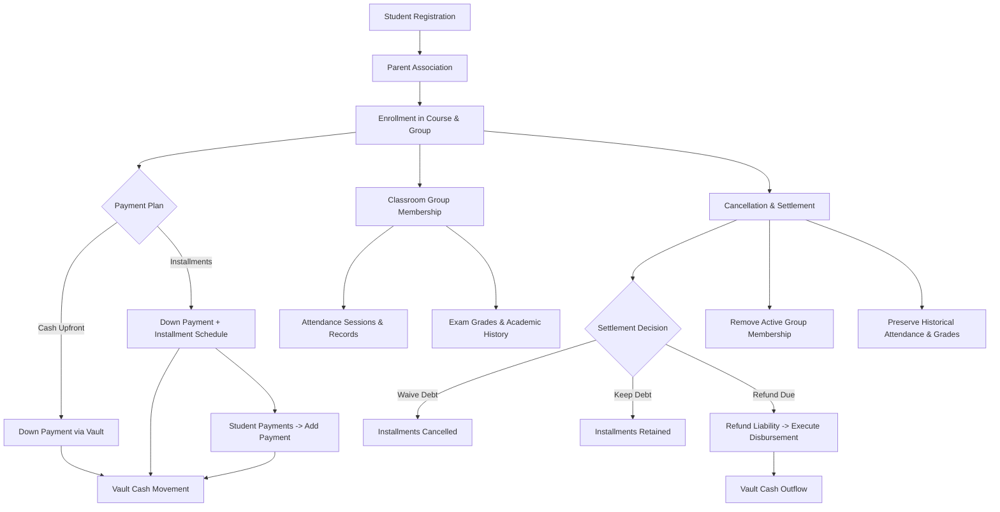

# 01 — EXISTING WORKFLOW MAP & SYSTEM ARCHITECTURE

## 1. Architectural Overview
This report documents the integrated architecture of AI School (Laravel 12 / Filament v3 / Livewire), mapping every service, model, and lifecycle event connecting registration, parent relations, academic enrollment, classroom grouping, down payments, installments, attendance, exams, cancellation, financial settlement, refund disbursement, and reporting.

## 2. Integrated Modules Matrix

| Module | Core Models | Primary Service | State Transitions | External Dependencies |
|---|---|---|---|---|
| Registration | `User`, `Student`, `StudentParent` | Filament Form Actions | Created $\rightarrow$ Active | Branch / Tenant Scope |
| Enrollment | `Enrollment`, `EnrollmentCourse` | `Enrollment::saving`, `CreateEnrollment` | Active $\rightarrow$ Cancelled / Completed | `Course`, `Group` |
| Down Payment | `Payment`, `Enrollment`, `Vault` | `PaymentObserver::class` | Inflow posted to Vault | `Vault::assertSufficientBalance` |
| Installments | `Installment` | `InstallmentCalculationService`, `PaymentObserver` | Pending $\rightarrow$ Partial $\rightarrow$ Paid / Cancelled | Seniority Allocation Engine |
| Attendance | `AttendanceSession`, `AttendanceRecord` | `AttendanceSession::created`, `AttendanceRecord` | Present, Absent, Late, Excused | Instructor Evaluation |
| Cancellation | `EnrollmentCancellation`, `Enrollment` | `EnrollmentCancellationService::class` | Active $\rightarrow$ Cancelled (Locked) | Debt Waiver / Retention |
| Refund | `Expense`, `Payment(refunded)`, `Vault` | `executeRefund` in Cancellation Service | Pending Refund $\rightarrow$ Completed | Reimbursing Vault |
| Reporting | All core transaction models | `ReportingCenterService::class` | Synchronous SQL aggregation | Multi-Tenant Branch Scoping |