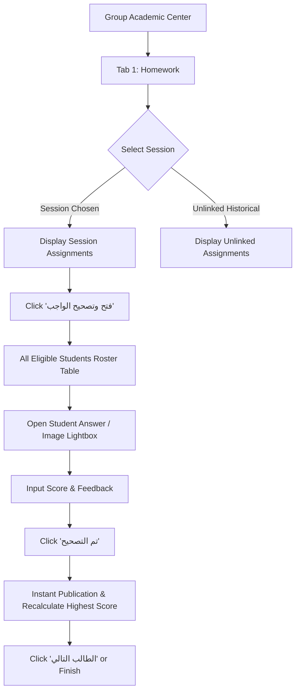

# 05 — HOMEWORK & SESSION WORKFLOW IMPLEMENTATION

## 1. Approved Workflow Architecture
The core instructor workflow in Tab 1 (الواجبات) adheres to:
**Group → Select Session → Select Homework → View All Eligible Students → Open Student Answer → Grade → Next Student**

## 2. Session Association & Historical Integrity
1. **Normalized Session Foreign Key:** Assignments link directly via `attendance_session_id` (or fallback `session_schedule_id`).
2. **Preservation of Unlinked Assignments:** Any historical assignments created without an explicit session link are preserved under a dedicated section: **"واجبات عامة غير مرتبطة بسيشن محدد"**.
3. **No Fake Sessions:** Historical assignments never have guessed or fabricated session dates assigned automatically.
4. **Resilience to Rescheduling:** Changing an `attendance_date` on an `AttendanceSession` does not break the assignment's link.

## 3. Preselection & Scope Guard
When an instructor creates an assignment from within an active session:
- The `group_id` and `attendance_session_id` are preselected automatically.
- Only students enrolled in that specific group are eligible for the assignment roster.
