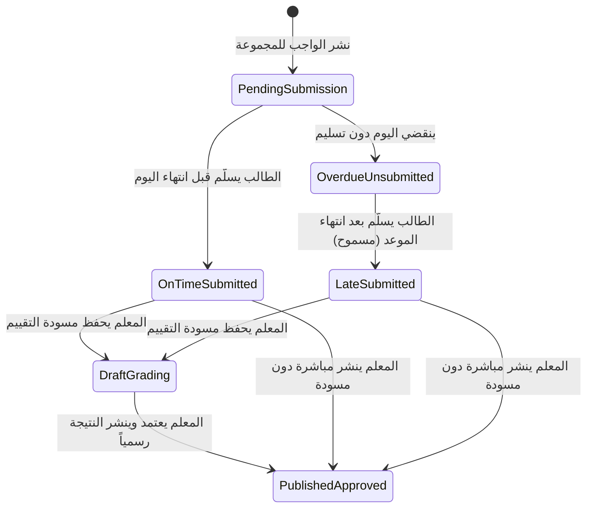

# قواعد وحالات دورة حياة الواجب والتسليمات المعتمدة
## Assignment & Submission Lifecycle Status Rules

---

### 1. استقلالية البعدين (Independence of Punctuality and Grading Dimensions)

أحد أهم المتطلبات الجوهرية للنظام هو المعاملة المستقلة تماماً بين بعدين مختلفين:
1. **بعد دقة وتوقيت التسليم (`Punctuality Dimension`):** يعكس التزام الطالب بالموعد النهائي.
2. **بعد التقدم الأكاديمي والتصحيح (`Grading Dimension`):** يعكس عمل المعلم في مراجعة واعتماد النتيجة.

> **قاعدة ذهبية:** الطالب الذي يسلّم الواجب متأخراً ويتم تصحيحه واعتماد درجته تظل حالته:  
> **(تم التصحيح والاعتماد) + (سلّم متأخرًا)**  
> لا يجوز أبداً محو شارة التأخير بمجرد رصد الدرجة.

---

### 2. مصفوفة حالات دقة التسليم (Punctuality Statuses)

| المعرف البرمجي | التسمية العربية الرسمية | الشرط المنطقي في الكود | شارة العرض |
|---|---|---|---|
| `pending_submission` | **بانتظار التسليم** | لا يوجد تسليم + الوقت الحالي لم يتجاوز الموعد النهائي (`now() <= due_date->endOfDay()`). | رمادي |
| `submitted_on_time` | **تم التسليم في الموعد** | يوجد تسليم + تاريخ التسليم قبل أو عند نهاية يوم الاستحقاق (`submitted_at <= due_date->endOfDay()`). | أخضر |
| `overdue` | **متأخر ولم يسلّم** | لا يوجد تسليم + الوقت الحالي تجاوز نهاية يوم الاستحقاق (`now() > due_date->endOfDay()`). | أحمر |
| `submitted_late` | **سلّم متأخرًا** | يوجد تسليم + تاريخ التسليم تجاوز نهاية يوم الاستحقاق (`submitted_at > due_date->endOfDay()`). | برتقالي داكن |

---

### 3. مصفوفة حالات التقييم والتصحيح (Review & Grading Statuses)

| المعرف البرمجي | التسمية العربية الرسمية | الشرط المنطقي في الكود | شارة العرض |
|---|---|---|---|
| `none` | **—** | لا يوجد تسليم من الطالب أصلاً. | رمادي |
| `awaiting_grading` | **بانتظار التصحيح** | يوجد تسليم من الطالب + لم يتم رصد أي درجة بعد (`score IS NULL AND published_at IS NULL`). | أزرق |
| `draft` | **مسودة تقييم** | يوجد تسليم + المعلم رصد درجة وملاحظات ولكن لم ينشرها (`score IS NOT NULL AND published_at IS NULL`). | برتقالي |
| `graded` | **تم التصحيح والاعتماد** | تم اعتماد النتيجة ونشرها رسمياً (`published_at IS NOT NULL`). | أخضر |

---

### 4. قاعدة حساب موعد نهاية اليوم (The End-of-Day Cutoff Rule)

لتفادي الأخطاء الشائعة التي تصنف الطلاب كمتأخرين في صباح يوم التسليم:
- إذا كان `Assignment.due_date` مخزناً كتاريخ مجرد مثل `2026-10-20`:
  - الموعد الحقيقي الصارم هو نهاية ذلك اليوم: `2026-10-20 23:59:59` (`endOfDay()`).
  - أي تسليم في الساعة `23:50` من يوم 20 أكتوبر يعتبر: **في الموعد (On Time)**.
  - أي تسليم في الساعة `00:05` من صباح 21 أكتوبر يعتبر: **متأخر (Late)**.
  - تم إثبات هذه القاعدة واختبارها عبر `TEST-013`.

---

### 5. دورة الانتقال بين الحالات (State Transitions)

